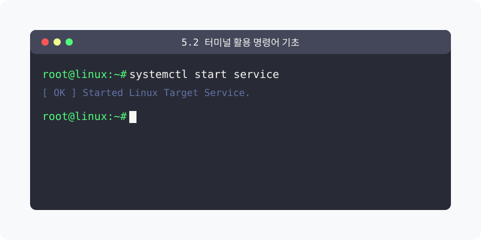
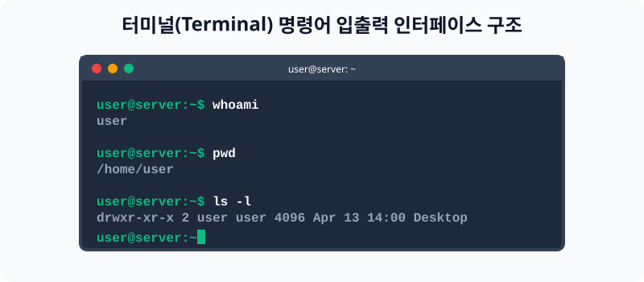

[⬅️ 이전: 7.2 반복/조건 제어문](../07_2_control/) &nbsp;|&nbsp; [🏠 분류 목차](../../) &nbsp;|&nbsp; [다음: 5장. 리눅스 시스템 관리 (System) ➡️](../../06_system/)



# 5.2 터미널 활용 및 CLI 시스템 명령어 기초

운영체제의 쉘(Shell) 시스템 환경에 진입했다면 본격적으로 명령어(Command)를 입력하여 리눅스 환경과 소통할 차례입니다. 서버 구축 및 관리에 빈번하게 쓰이는 가장 기초적인 시스템, 시각 관리 명령어들을 학습합니다.


> **동작 원리**: 그래픽 환경(마우스 조작)이 없는 서버 터미널에서는 오직 프롬프트(`$`) 우측에 문자로 명령(Command)을 내리고 결과(Output)를 단순한 텍스트 줄로 피드백 받는 CLI(Command Line Interface) 과정을 거칩니다.

---

## 1. 터미널 및 명령 관리 기본

터미널이나 콘솔 창을 열고 글씨를 다루거나 기록을 관리하는 기능입니다. 무수히 길어지는 터미널 텍스트들을 청소하는 기능이 포함됩니다. (이 기능들은 도움말 기능을 통해 상세히 확장 가능합니다.)

- **도움말**: 웬만한 명령어의 옵션 등은 항상 명령어 뒤에 `--help`를 붙여 알아볼 수 있습니다.
- **`clear`** : 길어진 현재 화면 정리 및 지우기 명령입니다. 단축키 `ctrl` + `l` 과 완벽하게 동일하게 작동합니다.
- **`history`** : 이전에 내가 입력했던 모든 명령어 기록 목록을 번호와 함께 출력합니다. 방향키(`↑/↓`)를 누르면 바로 전후 명령어를 다시 불러올 수도 있습니다.

---

## 2. 기본 시스템 상태 확인

가장 먼저 접속 직후 이 서버에 현재 누가 붙어 있는지, 시스템의 물리적인 환경은 어떠한지 식별하는 과정입니다.

- **`who`** : 현재 이 시스템(서버)에 누가 어떤 경로로 접속해 있는지 목록을 확인합니다.
- **`whoami`** : 현재 명령어 창을 키고 있는 내 자신의 계정 아이디를 확인합니다.
- **`w`** : 접속한 사용자는 물론이고 그 사람들이 무슨 작업을 하며 어떤 명령어를 돌리고 있는지 시스템 부하율과 함께 상세히 확인합니다.
- **`users`** : 접속한 사용자들의 간결한 이름 목록만을 출력합니다.
- **`id`** : 사용자의 고유 번호(UID)와 속한 그룹(GID) 번호를 자세하게 출력합니다.
- **`arch` / `uname`** : 시스템의 커널 구조 및 하드웨어 아키텍처(예: `x86_64`) 버전을 확인합니다.
- **`hostname`** : 현재 로그인 되어있는 서버 컴퓨터 본체의 네트워크 이름표를 보여줍니다.

---

## 3. 달력 및 디렉터리 탐색 출력

터미널 상에서 시간을 보거나 이동하기 전 현재 파일 시스템의 위치를 확인하는 기초입니다.

- **`cal`** : 현재 달의 달력을 터미널에 시각적으로 그려줍니다.
- **`date`** : 시스템 보드에 기록 중인 현재 연/월/일 및 시/분/초 서버 타임을 출력합니다.
- **`pwd`** (Print Working Directory): 광활한 파일 계층도 중에서, 내가 현재 위치한 디렉터리의 전체 절대 경로를 출력해 줍니다. 
- **`ls`** (List): 현재 있는 폴더 내부에 어떤 폴더와 파포함되어 있는지 그 목록을 전개합니다.
- [wc](/command/wc) 보강 학습: 파일 내부에 포함된 문자수나 줄 수를 셀 수 있습니다.

---

## 4. [실습] 자신의 터미널에서 동작해 보기

지금까지 학습한 기초 명령어들을 터미널 CLI 기반으로 직접 입력하고, 출력되는 문자를 확인해 보는 실습입니다. 가상 머신(혹은 WSL)의 검은 터미널 화면을 클릭한 상태에서 수행해 보세요!

### 실습 1. 나의 시스템 정보 및 위치 찾기
가장 많이 쓰이는 명렁어로 내가 누구인지, 내 서버의 경로가 어떻게 되는지 파악해 봅니다.
```bash
# 내 로그인 아이디 (예: root)가 화면에 출력됩니다.
whoami

# 내 서버 컴퓨터의 명칭 (예: localhost, ubuntu-server 등)
hostname

# 이 명령어를 친 순간의 내 터미널 현재 폴더 경로 반환
pwd
```

### 실습 2. 화면 정리 및 과거 수행 내용 추적
여러 명렁어를 치다 보면 터미널 창이 지저분해집니다. 이를 컨트롤하는 실습입니다.
```bash
# 그동안 쳤던 명령어들의 로그가 줄줄이 나타납니다.
history

# 너무 로그가 길어서 시야를 가린다면, 화면을 완전히 깨끗하게 청소합니다.
# (스크롤을 위로 올리면 복구되므로 삭제되는 것은 아님을 확인하세요)
clear
```

---

[⬅️ 이전: 7.2 반복/조건 제어문](../07_2_control/) &nbsp;|&nbsp; [🏠 분류 목차](../../) &nbsp;|&nbsp; [다음: 5장. 리눅스 시스템 관리 (System) ➡️](../../06_system/)
