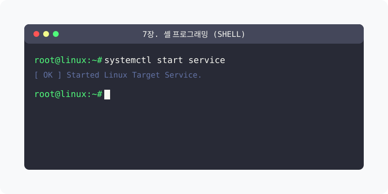
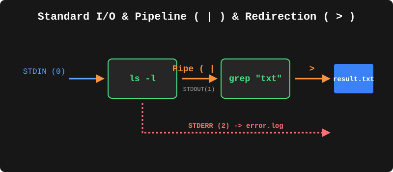

[⬅️ 이전: vi](../04_command/04_3_editor/04_3_4_edit/vi/) &nbsp;|&nbsp; [🏠 분류 목차](../) &nbsp;|&nbsp; [다음: 7.1 쉘 및 변수 기초 ➡️](07_1_intro/)

# 7장. 셸 프로그래밍 (Shell)

BASH 셸의 기본 원리를 이해하고 변수, 제어문, 함수를 활용한 강력한 스크립팅 자동화 역량을 배양합니다.
아래의 세부 학습 주제를 챕터별로 클릭하여 상세 레퍼런스를 확인하세요.

## 1️⃣ 핵심 학습 가이드
셸 프로그래밍의 기초 개념부터 고급 시스템 제어까지 3단계로 학습합니다.

* [7.1 쉘 및 변수 기초 (Intro)](07_1_intro/)

  리눅스 쉘 환경의 기본 개념과 쉘 변수 할당, 쉘 스크립트(.sh) 파일을 생성하고 구동하는 가장 기저의 원리를 다룹니다.

* [7.2 반복 및 조건 제어문 (Control)](07_2_control/)

  쉘 프로그래밍의 핵인 if/case 조건문 및 for/while 등 반복 루프를 통해 시스템 작업을 분기 처리하는 고급 로직을 실습합니다.

* [7.3 터미널 활용 명령어 기초 (Terminal)](07_2_terminal/)

  스크립팅을 벗어나 터미널 환경을 통제하는 기록 확인, 화면 클리어, 사용자 식별 등 필수 내장 명령어들을 다룹니다.

---

[⬅️ 이전: vi](../04_command/04_3_editor/04_3_4_edit/vi/) &nbsp;|&nbsp; [🏠 분류 목차](../) &nbsp;|&nbsp; [다음: 7.1 쉘 및 변수 기초 ➡️](07_1_intro/)
