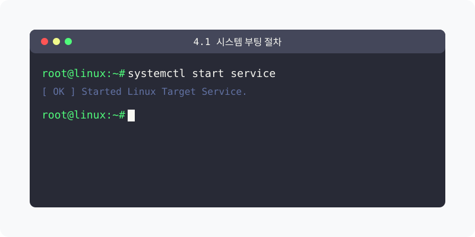
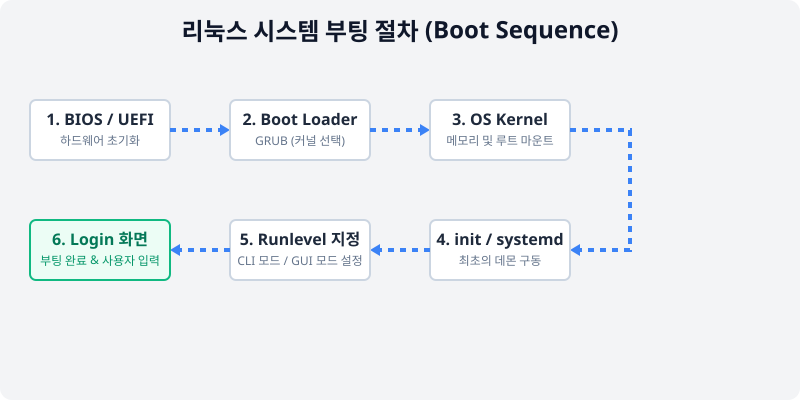
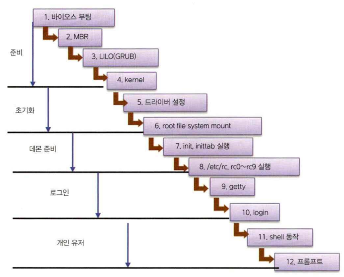
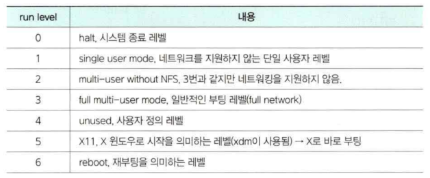

[⬅️ 이전: 5.1 시스템 부팅 메커니즘](../) &nbsp;|&nbsp; [🏠 분류 목차](../../../) &nbsp;|&nbsp; [다음: 4.2 리눅스 커널 구조 ➡️](../05_1_2_structure/)

# 4.1 리눅스 시스템 부팅 절차의 이해

리눅스 시스템은 전원 버튼을 누르는 순간부터 여러 단계의 복잡하고 상세한 과정을 거쳐 부팅됩니다. 윈도우와 달리 이 과정이 철저하게 개방되어 있으므로, 관리자는 시스템의 파악과 커스터마이징을 수행할 수 있습니다.

> **동작 원리**: 전원이 들어오면 하드웨어 검사(BIOS)를 수행하고, OS를 선택하는 부트 로더(GRUB)를 거쳐 커널이 메모리에 로드된 후 최초의 프로세스(init)가 런레벨(상태)를 결정하여 로그인 화면을 띄웁니다.

---

## 1. 단계별 부팅 진행 과정

리눅스 시스템에 처음 전원이 들어오면 약정된 각 단계를 순차적으로 거친 뒤 사용자가 사용할 수 있는 최종 상태로 부팅이 완료됩니다.

> (기존 작성된 부팅 과정 개요 자료입니다.)
> 

### 1.1 1단계: BIOS (또는 UEFI)
컴퓨터가 켜짐과 동시에 마더보드의 펌웨어인 **BIOS(또는 UEFI)** 가 가장 먼저 실행됩니다.
- **주요 역할**: 메인보드에 연결된 모든 물리적 하드웨어(CPU, RAM, 디스크 등)를 **초기화(검사)** 합니다.
- **부트 디바이스 선택**: 윈도우가 깔린 디스크로 갈지, 리눅스가 깔린 디스크나 USB 드라이브로 부팅할지 결정합니다.

### 1.2 2단계: 부트 로더 (Boot Loader)
선택된 디스크를 읽기 시작하면 가장 앞자리에 있는 **부트 로더** 프로그램이 구동됩니다.
- 리눅스에서는 주로 **GRUB (GRand Unified Bootloader)** 이 사용됩니다.
- **주요 역할**: 컴퓨터에 깔린 여러 운영체제 중 어떤 커널(Kernel) 이미지를 메모리로 불러올 것인지 메뉴를 띄워 줍니다.

### 1.3 3단계: 커널 로드 (Kernel Load)
부트 로더에 의해 메모리에 올라온 커널 이미지가 스스로의 압축을 풀고 활성화됩니다.
- 커널은 CPU, 시스템 자원들을 완전히 장악하여 배분 준비를 마치고, 가장 중요한 최상위 디렉터리인 루트(`/`) 파일 시스템을 마운트하여 디스크를 읽을 수 있게 만듭니다.

---

## 2. 시스템 서비스의 시작

하드웨어와 OS 엔진인 커널이 준비되었으므로, 이제 응용 프로그램(데몬)들을 깨울 차례입니다.

### 2.1 init (또는 systemd) 프로세스
커널 초기화가 끝나면 커널은 자신의 권한을 첫 번째 프로그램인 **init 프로세스(최근 배포판은 systemd)** 에게 넘겨줍니다.
- PID(프로세스 번호)가 무조건 '1번'인 최상위 부모 프로세스입니다.
- 네트워크, 웹 서버, 데이터베이스 등 설정된 모든 백그라운드 서비스(데몬)들을 구동하기 시작합니다.

### 2.2 런레벨 (Run Level) 결정
리눅스는 다중 사용자 시스템이므로, 단순히 전원이 켜졌다고 화면이 바로 나오는 것이 아니라 환경의 목적(Run Level)에 따라 모드가 결정됩니다.

> (기존 작성된 런레벨 설명 자료입니다.)
> 

- **0**: 시스템 강제 종료 모드
- **3 (다중 사용자 텍스트 모드)**: 화려한 그래픽 없이 검은 바탕에 흰 글씨(CLI)만 뜨는 서버 운영 체제의 기본 레벨. 가장 가볍고 빠릅니다.
- **5 (X-Window 그래픽 모드)**: 마우스가 지원되는 GUI 로그인 화면으로 부팅합니다. 개인이 쓰는 우분투 데스크톱의 기본값입니다.
- **6**: 시스템 재부팅

### 2.3 최종: 로그인 화면 출력
자신의 런레벨에 맞는 서비스 로딩이 완전히 끝나면 터미널이나 그래픽 창에 **로그인 화면(Login Prompt)** 이 출력되며, 이를 통해 사용자가 성공적으로 시스템에 접속할 수 있습니다.

---

[⬅️ 이전: 5.1 시스템 부팅 메커니즘](../) &nbsp;|&nbsp; [🏠 분류 목차](../../../) &nbsp;|&nbsp; [다음: 4.2 리눅스 커널 구조 ➡️](../05_1_2_structure/)
