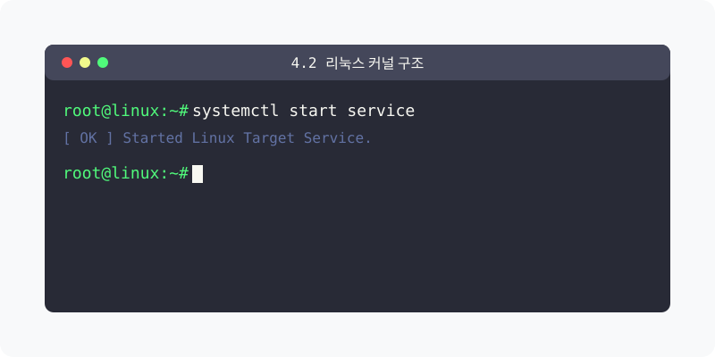

[⬅️ 이전: 4.1 시스템 부팅 절차](../05_1_1_boot/) &nbsp;|&nbsp; [🏠 분류 목차](../../../) &nbsp;|&nbsp; [다음: 5.2 프로세스 관리 ➡️](../../05_2_process/)

# 4.2 리눅스 커널(Kernel)의 이해와 버전 업그레이드

커널(Kernel)은 메모리나 CPU와 같은 필수 하드웨어와 응용 프로그램(Software) 사이에서 스케줄링을 해주는 **운영체제의 심장이자 본체**입니다. 전 세계의 오픈소스 개발자들이 이 리눅스 커널을 계속해서 발전시키고 있습니다.

<!-- Broken Image Removed: ./img/kernel_versions.svg -->
> **동작 원리**: 새로운 아이디어나 기능이 추가되면 가장 먼저 메인라인에서 실험이 진행되며, 이후 철저한 검증(RC)을 거쳐 버그가 제거된 완전한 상태가 안정화(Stable) 버전으로 출시되어 전 세계 서버에 탑재됩니다.

---

## 1. 커널 배포판의 구성 분류

리눅스 커널은 소스코드가 완전히 열려 있으므로 누구나 참여하여 수정할 수 있지만, 안정성을 확보하기 위해 엄격한 세 단계의 버전 라인을 거쳐 배포됩니다.

- **메인라인 버전 (Mainline Version)**: 리눅스의 창시자인 리누스 토르발스(Linus Torvalds)가 직접 깃허브(GitHub) 등에서 개발 및 병합을 주도하고 있는 최전방 버전입니다.
- **프리패치 버전 (Prepatch / RC Version)**: 안정 버전이 공식적으로 나오기 전, 새롭게 추가된 기능의 충돌이나 안정성을 미리 테스트해 보고 싶을 때 베타 테스트용으로 배포되는 버전입니다.
- **안정화 버전 (Stable Version)**: 프리패치를 통해 이미 무수히 많은 전 세계 사람들에게 검증된 개발 완료 코드로, 기업의 서버 등 중요한 실무 환경에 즉각적으로 쓰일 수 있는 고신뢰성 버전입니다.

---

## 2. 커널 버전 넘버링 규칙 (Naming Rule)

현재 리눅스 서버에 몇 버전의 심장이 탑재되어 있는지 파악하는 것은 보안과 확장성 측면에서 매우 중요합니다.

### 2.1 메이저와 마이너 넘버
> (기존 작성된 커널 버전 도해도 자료입니다.)
> <!-- Broken Image Removed: ./img/clip_image024.jpg -->

2019년 5월을 기준으로, 당시에 가장 안정화되었던 최신 커널은 **5.1.15** 버전이었습니다. 파일 이름에 붙은 숫자 (예: `5.1.15`)는 다음의 규칙을 의미합니다.

- **5 (주버전, Major Version)**: 엄청나게 큰 구조적 변화나 아키텍처 지원이 변경될 때 숫자가 올라갑니다.
- **1 (부버전, Minor Version)**: 시스템의 새로운 기능이나 드라이버들이 대량으로 추가되었을 때 숫자가 올라갑니다.
- **15 (패치 버전, Patch Version)**: 기능의 추가는 없으나 발견된 보안 취약점이나 잔여 버그들이 수정(패치)될 때마다 수시로 올라갑니다.

### 2.2 커널 사용자 컴파일
사용하고 있는 우분투나 로키 등의 배포판에 포함된 옛날 방식의 기본 커널을, 사용자가 직접 공식 웹사이트(kernel.org)에서 최신 소스 코드를 다운로드받아 번역하고 교체할 수 있습니다. 이를 통상적으로 **'커널 업그레이드'** 또는 **'커널 컴파일'** 이라 부릅니다.

---

[⬅️ 이전: 4.1 시스템 부팅 절차](../05_1_1_boot/) &nbsp;|&nbsp; [🏠 분류 목차](../../../) &nbsp;|&nbsp; [다음: 5.2 프로세스 관리 ➡️](../../05_2_process/)
