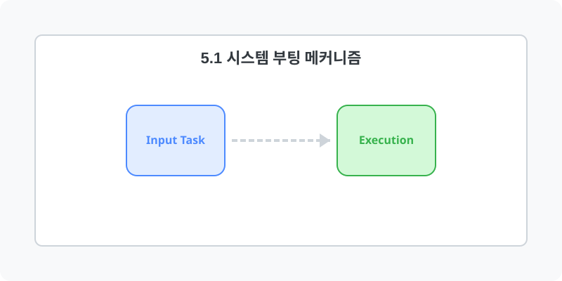

[⬅️ 이전: 5장. 리눅스 시스템 관리 (System)](../) &nbsp;|&nbsp; [🏠 분류 목차](../../) &nbsp;|&nbsp; [다음: 4.1 시스템 부팅 절차 ➡️](05_1_1_boot/)

# 5.1 시스템 부팅 메커니즘 및 커널
* [5.1.1 서버 부팅 과정 (Boot Flow)](05_1_1_boot/)
* [5.1.2 리눅스 커널 운영 체제 구조 (Structure)](05_1_2_structure/)

---

[⬅️ 이전: 5장. 리눅스 시스템 관리 (System)](../) &nbsp;|&nbsp; [🏠 분류 목차](../../) &nbsp;|&nbsp; [다음: 4.1 시스템 부팅 절차 ➡️](05_1_1_boot/)
