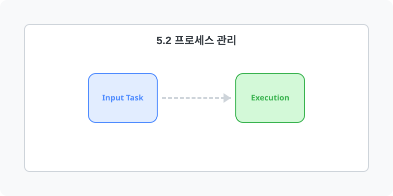

[⬅️ 이전: 4.2 리눅스 커널 구조](../05_1_boot/05_1_2_structure/) &nbsp;|&nbsp; [🏠 분류 목차](../../) &nbsp;|&nbsp; [다음: 4.3 프로세스(Process) 관리 ➡️](05_2_1_process/)

# 5.2 모니터링 및 프로세스 스케줄링
* [5.2.1 리눅스 프로세스 관리 실무](05_2_1_process/)

---

[⬅️ 이전: 4.2 리눅스 커널 구조](../05_1_boot/05_1_2_structure/) &nbsp;|&nbsp; [🏠 분류 목차](../../) &nbsp;|&nbsp; [다음: 4.3 프로세스(Process) 관리 ➡️](05_2_1_process/)
