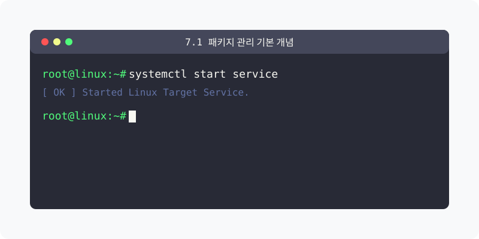
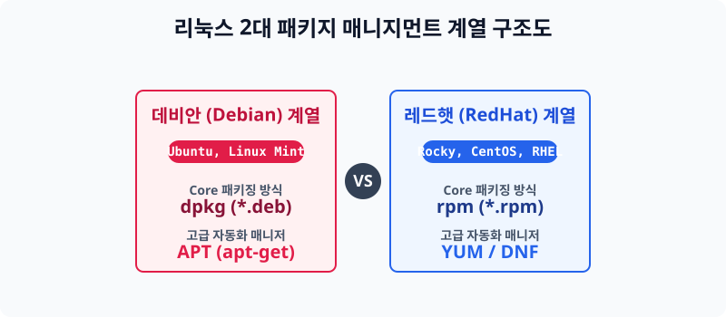

[⬅️ 이전: 5.3 리눅스 패키지 매니저](../) &nbsp;|&nbsp; [🏠 분류 목차](../../../) &nbsp;|&nbsp; [다음: apt-get ➡️](../05_3_2_apt/)



# 7.1 소프트웨어 설치 방식의 일원화, 패키지(Package) 개념

윈도우에서 `*.exe` 실행 파일을 다운로드 받아 마우스로 더블 클릭하여 프로그램을 까는 것처럼, 리눅스에서도 소프트웨어를 설치, 업그레이드, 삭제하기 위해 하나로 뭉쳐진 소프트웨어 파일 묶음을 **패키지(Package)** 라고 부릅니다. 


> **동작 원리**: 과거에는 소스코드를 직접 다운로드해 사용자가 수동으로 번역(컴파일)해서 썼기 때문에 설치가 매우 험난했습니다. 그러나 데비안 계열과 레드햇 계열에서 각각 네트워크 기반의 **'패키지 매니저(앱스토어 역할)'** 툴을 내놓으면서, 명령어 한 줄로 전 세계 서버에서 프로그램을 긁어와 쉽게 의존성을 해결하여 깔 수 있게 되었습니다.

---

## 1. 패키지(Package)의 어원과 종류
리눅스 서버 운영 체제의 양대 산맥에 따라 설치되는 패키지 프로그램의 포맷 역시 완전히 분단되어 있습니다. 윈도우용 프로그램이 맥북에서 깔리지 않는 것과 동일합니다.

### 1.1 데비안 계열 (DEB 패키지)
* **데비안(Debian), 우분투(Ubuntu)** 배포판에서 사용하는 패키지 관리 시스템입니다.
* 파일 확장자는 `*.deb` 로 묶여서 배포됩니다.
* 파일 자체를 직접 다룰 때는 `dpkg` 명령어를 쓰며, 최신 자동 다운로드 매니저는 `apt`를 씁니다.

### 1.2 레드햇 계열 (RPM 패키지)
* **페도라(Fedora), 센트OS(CentOS), 로키 리눅스(Rocky), RHEL** 배포판 등에서 사용합니다.
* 파일 확장자는 `*.rpm` 으로 묶여서 배포됩니다.
* 패키지 자동 분배 다운로드를 위해 과거엔 `yum`을 오랫동안 쓰다가, 근래에는 성능이 대폭 향상된 최신 매니저인 `dnf`로 세대교체가 되었습니다.

---

## 2. 패키지 파일명 이름 짓기 규칙
실제로 여러분의 시스템이나 서버에 저장되는 파일명은 다음과 같은 고유의 규칙을 따르고 있습니다. (RPM 기준)

> 형식: `{패키지이름}-{버전}-{개정번호/릴리즈}.{아키텍처}.rpm`

- **패키지이름**: 프로그램 고유 명칭입니다. (예: `nginx`, `mysql`)
- **버전**: 메이저(Major), 마이너(Minor), 패치(Patch) 등으로 이루어진 숫자. 새 기능이 나오면 올라갑니다.
- **개정번호(Revision/Release)**: 자체적인 호환성 버그나 사소한 것을 해결할 때마다 올라갑니다. 높을수록 최신입니다.
- **아키텍처**: 시스템 규격. x86의 32비트는 `i386`이라고 찍히고, 요즘 세상의 64비트는 `x86_64` 등으로 찍힙니다.

---

## 3. [실습] 내 서버가 어떤 패키지 매니저를 쓰는지 파악하기
명령어를 직접 쳐서, 본인이 붙은 터미널 장비가 데비안(우분투) 시스템인지 레드햇(로키) 시스템인지 알아냅니다.

### 실습 1. 매니저 존재 유무 테스트
```bash
# apt 패키지 매니저의 버전을 봅니다. (우분투라면 버전 숫자가 나오고, 로키라면 command not found가 뜹니다)
apt --version

# yum(또는 dnf) 의 버전을 봅니다. (로키라면 버전 숫자가 나오고, 우분투라면 보통 없다고 뜹니다)
dnf --version
```

---

[⬅️ 이전: 5.3 리눅스 패키지 매니저](../) &nbsp;|&nbsp; [🏠 분류 목차](../../../) &nbsp;|&nbsp; [다음: apt-get ➡️](../05_3_2_apt/)
