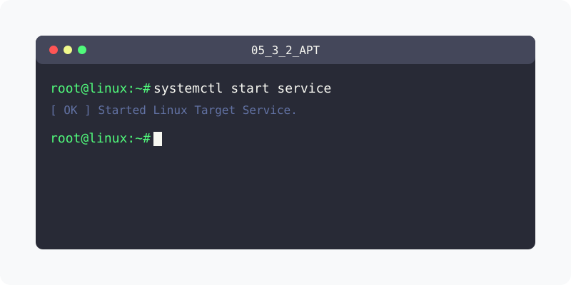

[⬅️ 이전](../) &nbsp;|&nbsp; [🏠 분류 목차](../../../)

# apt-get

## 1️⃣ 핵심 학습 가이드
방대한 주제를 분할하여 제공합니다.

* [apt-get의 개요](part_1/)

  해당 파트의 상세 내용을 학습합니다.

* [apt-get  기본 사용법](part_2/)

  해당 파트의 상세 내용을 학습합니다.

* [apt-cache](part_3/)

  해당 파트의 상세 내용을 학습합니다.

---

[⬅️ 이전](../) &nbsp;|&nbsp; [🏠 분류 목차](../../../)
