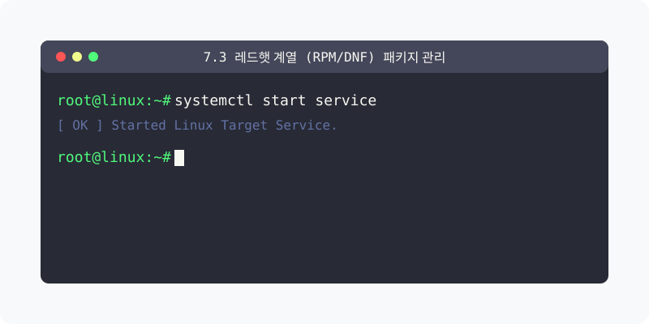

[⬅️ 이전](../) &nbsp;|&nbsp; [🏠 분류 목차](../../../)

# 7.3 레드햇 계열 (Rocky/CentOS) DNF 패키지 관리

대형 글로벌 금융권 서버 등에서 압도적으로 많이 쓰이는 RHEL(레드햇) 운영체제 기반의 패키지 관리 도구인 **DNF**의 개념과 실무 활용법을 알아봅니다.

## 1️⃣ 핵심 학습 가이드
방대한 주제를 분할하여 제공합니다.

* [1. YUM의 진화 DNF Dandified Yum 개요](part_1/)

  해당 파트의 상세 내용을 학습합니다.

* [2. 필수 시스템 패키지 명령어 DNF](part_2/)

  해당 파트의 상세 내용을 학습합니다.

* [4. 실습 DNF를 활용한 로키Rocky 리눅스 패키지 제어](part_3/)

  해당 파트의 상세 내용을 학습합니다.

---

[⬅️ 이전](../) &nbsp;|&nbsp; [🏠 분류 목차](../../../)
