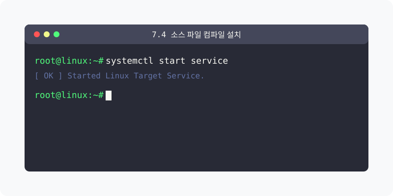
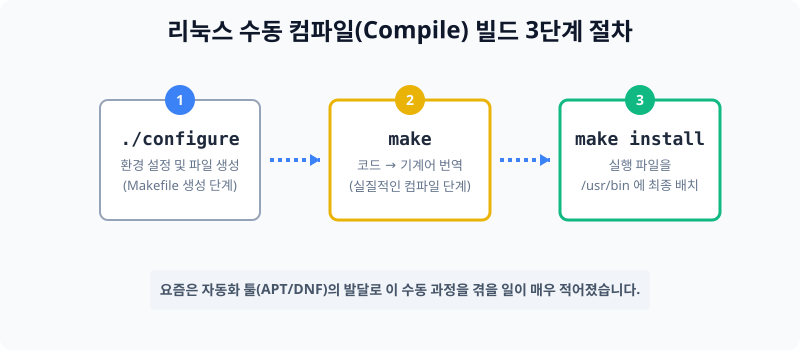

[⬅️ 이전: 7.3 레드햇 계열 (RPM/DNF) 패키지 관리](../05_3_3_dnf/) &nbsp;|&nbsp; [🏠 분류 목차](../../../) &nbsp;|&nbsp; [다음: 13.2 예약 및 정기구동 (cron) ➡️](../../05_4_cron/)



# 7.4 근본적인 설치 방식, 수동 컴파일(Compile)

모든 프로그램은 개발자가 인간의 언어(C, Java 등)로 짠 코드를 기계가 알아들을 수 있는 언어(0과 1)로 번역해주는 과정을 거칩니다. 이 번역 작업을 스스로 수행하며 소프트웨어를 까는 행위를 **수동 컴파일 설치**라고 합니다.


> **동작 원리**: 과거에는 `apt`와 같은 자동화 스토어가 없었기 때문에, 깃허브 등에서 압축된 날것의 '소스 코드' 뭉치를 다운받아 위 3단계를 직접 입력해야만 컴퓨터에 프로그램이 설치되었습니다.

---

## 1. 컴파일(Compile) 설치의 주요 장단점

리눅스는 운영 체제 자체를 수많은 전 세계 개발자들이 유지/보수하기 때문에, 개발 언어를 담은 소스 코드를 아예 대놓고 뿌려서 누구나 가져다가 컴파일 할 수 있게 배포합니다.

### 1.1 컴파일 방식의 장점 (최적화)
내 서버 하드웨어(CPU, RAM 성능)의 한계를 직접 쥐어짜며 코드를 번역하기 때문에, 내 서버 환경에 **가장 완벽하게 최적화(Optimization)** 된 세상에 하나뿐인 나만의 맞춤형 실행 파일을 얻어낼 수 있습니다.
- 남들보다 속도가 더 빠르고 가벼울 수 있습니다.
- 버그나 오류 코드를 내 마음대로 개조해서 낄 수 있습니다.

### 1.2 컴파일 방식의 단점 (의존성 지옥)
모든 걸 수동으로 깎아 만들어야 하다 보니, 이 프로그램 구동에 필요한 다른 서브 파일(의존성 라이브러리)이 단 하나라도 내 시스템에 없으면 번역 도중에 아주 복잡한 에러(Error)를 내뿜으며 아예 멈춰버립니다. 초보자가 다루기 위해선 엄청난 시간과 지식이 필요합니다.

---

## 2. 수동 컴파일 설치의 기본 3단계 절차

`wget` 이나 브라우저 등을 통해 `.tar.gz` 로 묶인 소스 코드를 서버로 다운로드 받아 압축을 풀었다고 가정했을 때, 폴더에 진입하여 보통 다음 3가지 명령어를 연달아 치면 설치가 시작됩니다.

### 2.1 1단계: `./configure` (환경 체크)
현재 내 서버의 CPU, 메모리 버전을 체크하고 어떠한 방식으로 컴파일을 할 것인지 청사진(Makefile)을 찍어내는 환경 체크업 과정입니다. 이 단계에서 에러가 가장 많이 터집니다.

### 2.2 2단계: `make` (본격 번역 시작)
앞 단계의 청사진을 바탕으로 소스 코드를 컴퓨터 기계어로 번역하는 **"진짜 컴파일"** 과정입니다. 용량이 큰 데이터베이스나 운영체제를 make 하면 서버가 굉음을 내며 몇 시간이 걸리기도 합니다. 

### 2.3 3단계: `make install` (완제품 복사)
완벽하게 번역이 끝나 만들어진 윈도우의 `*exe` 역할과 동일한 핵심 실행 파일들을, 서버의 주요 위치(`/usr/bin` 등) 시스템 안쪽으로 밀어 넣어 최종 배치를 완료하는 과정입니다. 권한이 필요하므로 보통 `sudo make install` 로 수행합니다.

---

## 3. [실습] Make 컴파일 도구의 존재 확인해보기
본인의 서버 환경에서 무언가 프로그램을 손수 구워낼(Make) 수 있는 필수 도구들이 깔려 있는지 버전을 확인해 봅니다. 도구가 없다고 뜨면 패키지 매니저로 깔아 줍니다.

### 실습 1. Make 빌드 툴 존재 확인
```bash
# make 번역 툴킷 버전 확인
make --version

# gcc (리눅스 최고 존엄 C언어 컴파일러 엔진) 버전 확인
gcc --version
```

### 실습 2. 만약 안 깔려 있다면 어떻게 하나요?
보통 최근의 우분투/데비안 배포판들은 이런 필수 수동 도구들을 `build-essential` 이라는 거대한 패키지 묶음으로 묶어 두었습니다.
```bash
# APT를 활용해 컴파일 작업에 필요한 도구들을 한마당 다 받아올 수 있습니다.
sudo apt update
sudo apt install -y build-essential
```

---

[⬅️ 이전: 7.3 레드햇 계열 (RPM/DNF) 패키지 관리](../05_3_3_dnf/) &nbsp;|&nbsp; [🏠 분류 목차](../../../) &nbsp;|&nbsp; [다음: 13.2 예약 및 정기구동 (cron) ➡️](../../05_4_cron/)
