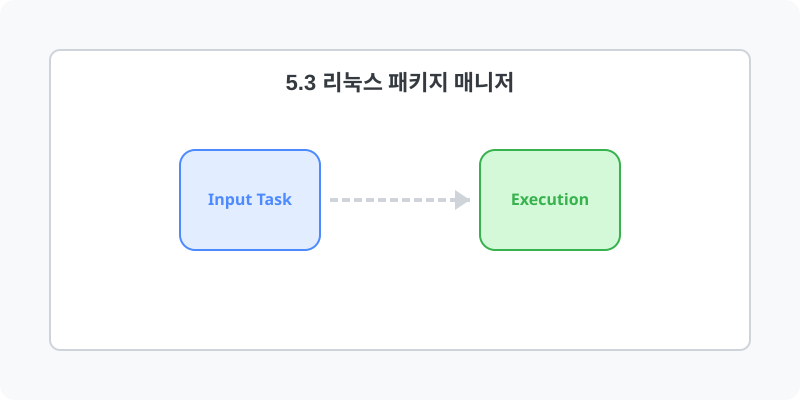

[⬅️ 이전: 4.3 프로세스(Process) 관리](../05_2_process/05_2_1_process/) &nbsp;|&nbsp; [🏠 분류 목차](../../) &nbsp;|&nbsp; [다음: 7.1 패키지 관리 기본 개념 ➡️](05_3_1_manager/)

# 5.3 패키지 매니저 활용 (Package)

## 1️⃣ 핵심 학습 가이드
* [5.3.1 패키지 관리시스템의 기본 개념](05_3_1_manager/)
* [5.3.2 데비안 계열 의존성 제어 (APT)](05_3_2_apt/)

## 2️⃣ 심화 및 활용 파트 1
* [5.3.3 레드햇 계열 서버 제어 (DNF/RPM)](05_3_3_dnf/)
* [5.3.4 직접 소스코드 컴파일 설치 (Compile)](05_3_4_compile/)

---

[⬅️ 이전: 4.3 프로세스(Process) 관리](../05_2_process/05_2_1_process/) &nbsp;|&nbsp; [🏠 분류 목차](../../) &nbsp;|&nbsp; [다음: 7.1 패키지 관리 기본 개념 ➡️](05_3_1_manager/)
