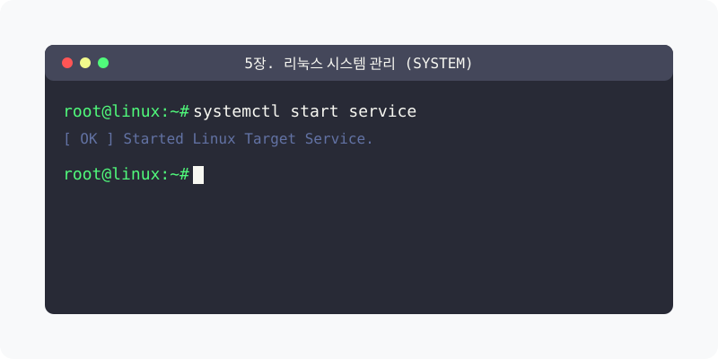

[⬅️ 이전: 5.2 터미널 활용 명령어 기초](../05_shell/07_2_terminal/) &nbsp;|&nbsp; [🏠 분류 목차](../) &nbsp;|&nbsp; [다음: 5.1 시스템 부팅 메커니즘 ➡️](05_1_boot/)

# 5장. 리눅스 시스템 관리 (System)

단순한 명령어 활용을 넘어 리눅스 커널의 부팅 과정과 시스템의 핵심 자원인 프로세스 및 디스크를 실무적으로 관리하는 단계에 돌입합니다.

본 단원의 세부 커리큘럼을 안내합니다.

## 1️⃣ 핵심 학습 가이드
* [5.1 시스템 부팅 (Boot)](05_1_boot/)

* [5.2 프로세스 기초 (Process)](05_2_process/)

## 2️⃣ 심화 및 활용 파트 1
* [5.3 패키지 관리 (Package)](05_3_package/)

* [5.4 작업 스케줄링 (Cron)](05_4_cron/)

## 3️⃣ 심화 및 활용 파트 2
* [5.5 스토리지 및 볼륨 (Storage)](05_5_storage/)

## 3️⃣ 심화 및 활용 파트 2
---

[⬅️ 이전: 5.2 터미널 활용 명령어 기초](../05_shell/07_2_terminal/) &nbsp;|&nbsp; [🏠 분류 목차](../) &nbsp;|&nbsp; [다음: 5.1 시스템 부팅 메커니즘 ➡️](05_1_boot/)
