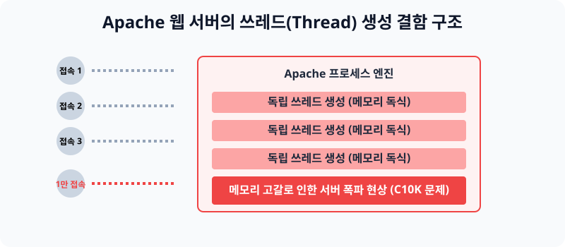

# 11.2 전통의 웹 호스팅 강자, 아파치(Apache) 입문

아파치 서버는 과거 리눅스 초창기부터 1순위로 채택되었던 가장 표준적인 크로스 플랫폼 오픈소스 웹 서버입니다. 전 세계 절반 이상의 웹사이트가 과거 이것으로 개발되었지만 현재는 구형 스펙의 한계를 맞이하고 있습니다.


> **동작 원리**: 아파치 엔진은 브라우저 접속자 1명이 홈페이지를 클릭할 때마다 서버 내부에 무거운 독립 '쓰레드(Thread)' 방을 하나씩 만들어서 그 손님만 전담 마크하도록 배정합니다. 손님이 1만 명으로 몰리는 소위 [C10K] 문제가 발생하면, 메모리에 방을 1만 개나 새로 창조하면서 서버 컴퓨터가 터져 버립니다.

---

## 1. 아파치 기본 설치 및 서비스 관리

우분투가 켜진 상태에서 `apt` 데비안 명령어 생태계를 활용하여 아파치 최신버전(`apache2`)을 자동 설치합니다.

### 1.1 Apache 엔진 다운로드
```bash
# 구글 리전 서버에서 apache2 최신 껍데기를 다운로드 및 백그라운드 자동 기동합니다.
sudo apt update
sudo apt install -y apache2

# 정상적으로 깔려있는지 자신의 버전을 확인합니다
apache2 -v
```

### 1.2 systemctl 로 엔진 제어하기
이전 단원에서 학습한 통합 통제 리모콘으로 설치된 아파치의 시동을 걸거나 끕니다. (서비스명에 2가 붙습니다.)
```bash
# 아파치가 살아있는지 헬스체크 진단
sudo systemctl status apache2

# 다운되었을 경우 재시동
sudo systemctl restart apache2
```

---

## 2. 웹 서버 접속 모니터링 체계 점검

아키텍처가 구동되었다면 인터넷 포트를 통해 방화벽을 잘 뚫고 내 안으로 통로가 열렸는지 최종 진단해 봅니다.

**(1) 본인의 윈도우 크롬 창에서 우분투 IP(`127.0.0.1` 등) 쳐서 기본 사이트 화면 확인**
> 

**(2) Listen 포트 (웹서버 80번) 오픈 모니터링 확인**
서버의 통신망인 `netstat -ntlp` 명령어를 쳐서 아파치가 80번 포트를 꽉 물고 있는 화면을 점검합니다.
> 

---

## 3. 핵심 문서 폴더 변경 에러 해결 (권한 부여)

아파치가 처음 켜지면 손님들에게 텍스트를 돌려주기 위해 `/var/www/html` 이라는 기본 디렉터리를 기준(Document Root)으로 사용합니다. 만약 여러분이 야믈(.conf) 설정 파일을 열어 이 작업 폴더 위치를 `home/mypage` 처럼 임의로 비틀어버리면 무조건 권한 에러(Permission Denied)가 터집니다.

이를 막기 위해 메인 방화벽과 환경설정 텍스트를 다음과 같이 보정해야 합니다.

**(1) 아파치 디렉터리 권한 `granted` 로 통제 해제하기**
> 

**(2) 우분투 UFW 메인 방화벽 80번 HTTP 통신문 박살내어 뚫어버리기**
> 

---

## 4. [실습] 나의 첫 번째 Apache 홈페이지 만들기

리눅스 서버에 텍스트 편집기 등을 활용해 나만의 최초 인터넷 서버 문서를 저장하고 브라우저로 띄우는 실습입니다.

### 실습 1. index.html 화면 커스텀
아파치가 바라보고 있는 메인 무대에 들어가서, 메인 홈페이지 그림을 새로 그립니다.
```bash
# 아파치의 기본 작업실 폴더로 터미널 이동합니다.
cd /var/www/html

# 기존에 덮여 있던 못생긴 우분투 기본 페이지를 삭제해버립니다.
sudo rm index.html

# nano 에디터로 새로운 홈페이지 소스코드를 작성합니다.
sudo nano index.html
```

### 실습 2. 코드 삽입!
에디터 화면이 열리면 아래와 같이 타이핑을 치고 저장(`Ctrl+O, Enter, Ctrl+X`)합니다.
```html
<h1>[긴급] 내 서버 컴퓨터 해킹에 성공함!</h1>
<h2>여기는 리눅스 11단원 테스트 영역입니다.</h2>
```

**[확인]**: 본인의 윈도우 노트북 크롬 브라우저를 켜고 다시 당신의 리눅스 IP를 타건해 봅니다. 화면이 새로 작성한 글씨로 바뀌어 띄워진 것을 두 눈으로 모니터링합니다.
