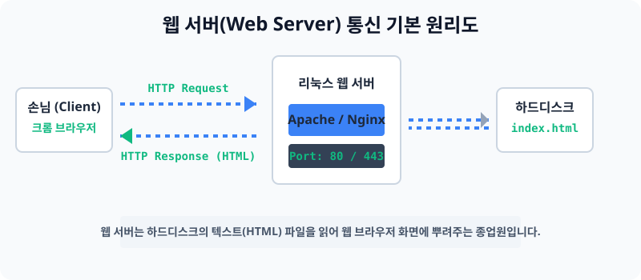

# 11.1 전 세계를 하나로 연결하는 웹 서버 환경 구축

앞선 단원에서 통신 네트워크 구조를 구축하고, 유령처럼 항상 떠 있는 데몬 프로세스의 작동 원리를 이해했습니다. 이제 이 두 개의 메커니즘을 하나로 결합하여 24시간 내내 사용자들의 브라우저 화면에 예쁜 그림과 글씨를 전달해 주는 진짜 **웹 서버(Web Server)** 를 띄워볼 차례입니다.


> **동작 원리**: 웹 서버 소프트웨어(Apache 또는 Nginx)는 리눅스의 하드디스크 파일 경로(`/var/www/html`) 안에 저장된 정적인 그림 파일이나 HTML 텍스트 코드를 미리 쥐고 대기합니다. 그리고 손님들(Client)이 주소창을 치고 HTTP 요청을 던지면, 하드디스크에 있던 파일을 그대로 싹 포장해서 응답(Response)해 뿌려줍니다. 

---

## 1. 웹 서버의 주요 역할
* 웹 서버란, 인터넷 상의 클라이언트로부터 데이터 요청(Request)을 받아 처리하고 다시 완성된 웹 페이지를 전송(Response)해 주는 호스팅 프로그램 엔진을 말합니다.
* 예전에는 컴퓨터 자체가 웹 서버로 통칭되었으나, 현대에는 우분투 운영체제 위에 부품처럼 올라가는 **웹 서비스 관리 데몬 프로세스**를 칭합니다.

## 2. 웹 서버 시장의 양대 산맥 경쟁
리눅스에 설치할 수 있는 웹 서버 소프트웨어는 구형부터 최상위 스펙까지 매우 많습니다만 현업에서는 단 2가지 소프트웨어가 전 세계 인터넷 시장을 다투고 있습니다. 각자의 장단점이 뚜렷합니다.

### 2.1 아파치 (Apache HTTP Server)
* **전통의 강자**: 1995년부터 전 세계 1등을 놓치지 않던 가장 낡고 엄청나게 방대하며 대중적인 웹 서버입니다.
* 장점: 역사가 오래되어 수천 가지가 넘는 추가 플러그인(확장 모듈)이 존재하여 못하는 게 없습니다.
* 단점: 접속자가 1만 단위로 넘어가면 메모리를 미친 듯이 박살 내며 속도가 심각하게 죽어버리는 약점이 있습니다.

### 2.2 엔진엑스 (Nginx)
* **초고속 신예 강자**: 아파치의 무거운 동작 속도와 대규모 접속자 다운 현상을 해결하기 위해 2004년에 만들어진 가벼운 초고속 아키텍처 웹서버입니다.
* 장점: 비동기 방식 도입으로 동시에 수십 만명이 몰려도 멈추지 않고 초스피드로 인터넷 창을 띄워주는 미친 성능을 보여줍니다. (현대의 대기업 표준 장비로 등극했습니다.)
* 단점: 아파치보다는 유연한 플러그인 기능이 살짝 적습니다.

---

## 3. [실습] 내 서버 인터넷 접속 포트 오픈하기
웹 서버 엔진을 설치하기 전에, 가장 기본적으로 방화벽에서 일반 사람들의 출입문인 인터넷 전용 80번, 443번(보안) 항구를 미리 열어두는 실습입니다.
```bash
# 본인의 우분투 리눅스 터미널에서 다음으로 80번(HTTP) 문을 엽니다.
sudo ufw allow 80/tcp

# 이어서 443번(HTTPS) 암호화 통신 포트도 열어둡니다.
sudo ufw allow 443/tcp

# 열린 문 상태를 조회합니다.
sudo ufw status
```