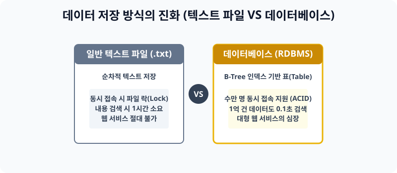

# 12.1 인터넷 서비스의 궁극적 심장, 데이터베이스(DB)

지금까지 설치했던 Nginx 웹 서버는 정적인 그림판을 보여줄 뿐입니다. 사용자가 직접 회원 가입 버튼을 눌러 자신의 아이디와 비밀번호, 그리고 게시판에 작성한 글을 영구히 저장하려면 리눅스에 완전히 새로운 '수납장 엔진'인 **데이터베이스(Database)** 데몬 프로세스를 구동해야 합니다.

> **동작 원리**: 데이터를 엑셀(txt/csv) 파일에 저장하면 수백 명이 동시에 글을 남길 때 파일 충돌(Lock)이 터져 데이터가 다 날아갑니다. 반면 RDBMS 데이터베이스 데몬은 인덱스(B-Tree) 기반의 표(Table)로 데이터를 관리하며, 수백만 사용자가 동시에 몰려도 체계적으로 교통 정리를 해 줍니다.

---

## 1. 관계형 데이터베이스(RDBMS)의 역사
인터넷 웹사이트 시장의 99% 는 '표(Table)' 형태로 데이터를 묶어 관리하는 관계형 방식을 채택합니다.

* **Oracle Database**: 데이터 하나에 수천만 원의 가치가 있는 은행권, 국가 기관 등에서 수십억을 주고 사용하는 최고급 폐쇄망 데이터베이스입니다. 무지막지하게 무겁고 비쌉니다.
* **MySQL**: 전 세계 인터넷 홈페이지 생태계를 폭발시킨 무료 RDBMS 시스템 데몬입니다. 굉장히 가볍고 속도가 빠르며 대부분의 클라우드 플랫폼에서 표준으로 쓰입니다. 나중에 썬(Sun)과 통합되어 유료화 논란이 있었습니다.
* **MariaDB**: 위 MySQL의 유료화 행보에 빡친(?) 오리지널 개발자들이 나와서 핵심 구조만 똑같이 복제해서 만든 쌍둥이형 100% 무료 오픈소스 DB입니다. 명령어마저 완벽히 동일합니다.

## 2. NoSQL (Not Only SQL) 데이터베이스
엄격하게 엑셀 표(가로, 세로)에 맞춰 저장해야 하는 RDBMS의 틀을 부수고 등장한 신식 자유형 저장소입니다.

* **MongoDB**: 회원들의 복잡하고 유동적인 정보(json 포맷 배열)를 표가 아닌 비정형 텍스트 덩어리로 던져버릴 수 있게 해주는 데이터베이스입니다. 게시판 구조가 수시로 바뀌는 스타트업에서 유행합니다.
* **Redis (레디스)**: 하드디스크가 아닌 **메모리(RAM) 상주형** 데이터베이스로 빛의 속도를 자랑합니다. BTS 티켓팅이나 네이버 실시간 검색어 같은 초고속 일회용 캐시 데이터 처리에 주로 씁니다.

---

## 3. [개념 정리] SQL 이란 무엇인가요?
데몬 프로세스(MySQL)가 구동되면, 우리는 이 유령 엔진과 대화를 나누기 위해 마우스를 딸깍이는 대신 프로그래밍 언어를 타건해야 합니다. 이때 사용하는 전 세계 표준 명령 문법을 `SQL(Structured Query Language)` 라고 합니다.
* 예: `SELECT * FROM tbl_member WHERE userid = 'hojin';` (회원 테이블에서 hojin 아이디를 찾아라)
