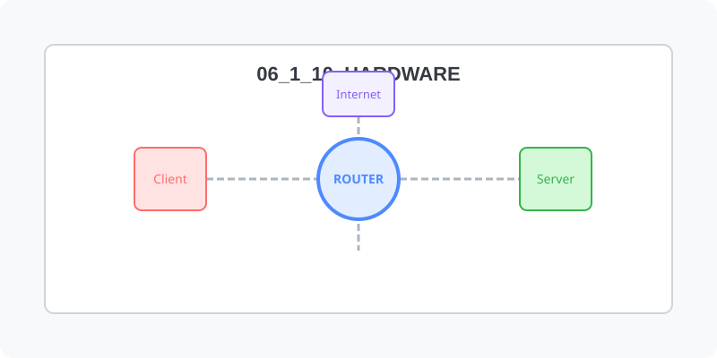

[⬅️ 이전](../) &nbsp;|&nbsp; [🏠 분류 목차](../../../)

# 네트워크

방대한 주제를 분할하여 제공합니다.

## 1️⃣ 핵심 학습 가이드
* [네트워크 구성](part_1/)

  해당 파트의 상세 내용을 학습합니다.

* [LAN](part_2/)

  해당 파트의 상세 내용을 학습합니다.

## 2️⃣ 심화 및 활용 파트 1
* [WAN](part_3/)

  해당 파트의 상세 내용을 학습합니다.

* [스위치 와 허브](part_4/)

  해당 파트의 상세 내용을 학습합니다.

## 3️⃣ 심화 및 활용 파트 2
* [라우터](part_5/)

  해당 파트의 상세 내용을 학습합니다.

## 3️⃣ 심화 및 활용 파트 2
---

[⬅️ 이전](../) &nbsp;|&nbsp; [🏠 분류 목차](../../../)
