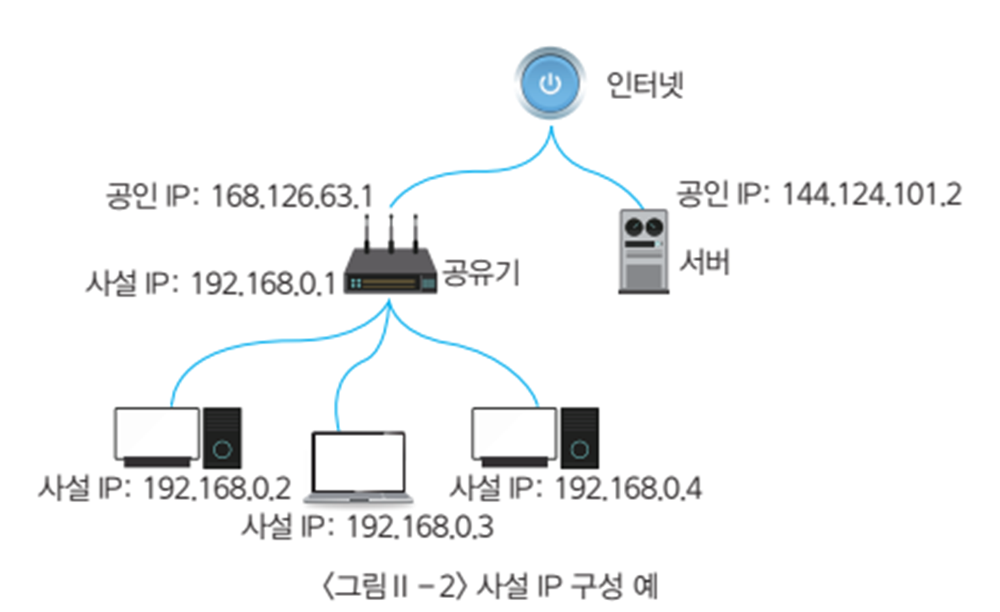

[⬅️ 이전](../) &nbsp;|&nbsp; [🏠 분류 목차](../../../)

# 네트워크 구성

## 네트워크 구성
현대의 수많은 컴퓨터 들을 네트워크망을 통하여 서로 연결되어 있습니다. 또한, 이렇게 컴퓨터들을 연결해주는 망을 네트워크라 합니다.

많은 수의 컴퓨터들이 서로 연결을 하기 위해서는 다양한 장비들이 필요로 합니다. 
> 각각의 장비들은 충돌되지 않고 서로를 인식할수 있도록 IP 주소와 MAC 주소를 가지고 있습니다.

### 유선 네트웍

### 무선 네트웍
* wifi란?
> 정리과제

---

[⬅️ 이전](../)
