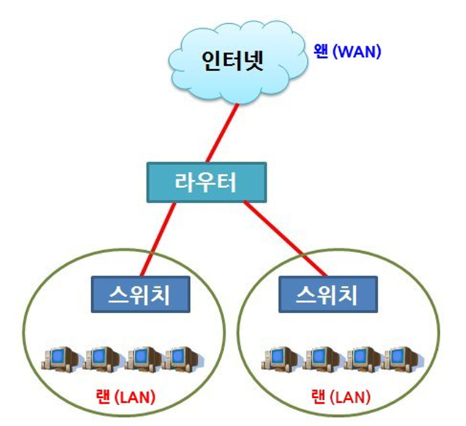

[⬅️ 이전](../) &nbsp;|&nbsp; [🏠 분류 목차](../../../)

# LAN

## LAN
---
LAN (Local Area Network)

* 작은 영역의 네트워크 연결

* 네트워크의 최소 단위 (사이즈는 다양)

* 장치: 허브, 스위치(L2)

Layer 2 은 LAN, Layer 3은 WAN임

---

[⬅️ 이전](../)
