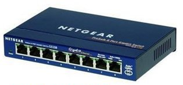
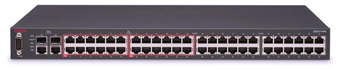
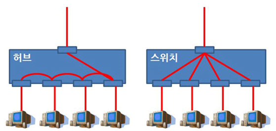

[⬅️ 이전](../) &nbsp;|&nbsp; [🏠 분류 목차](../../../)

# 스위치 와 허브

## 스위치 와 허브
---
같은 네트워크 안의 연결을 돕는 통신 장치 (외부망으로 나가지 못함)

### 허브

* 하나의 네트워크 라인에 여러대의 컴퓨터를 분배하는 장치

* 한번에 하나의 컴퓨터에만 데이터 전송 가능

* 멀티탭 같은 역할

* 저가 장비

### 네트워크 스위치(network switch)

* 허브와 같은 기능, 하나의 네트워크 라인에 여러대의 컴퓨터를 분배하는 장치

* 높은 데이터 전송 대역으로, 허브보다 향상된 네트워크 속도를 제공

* 처리 가능한 패킷의 숫자가 크고, 송신과 수신이 동시에 일어남

* 동시에 여러 컴퓨터로 데이터를 전송 가능

* 허브보다 고가 장비

---

[⬅️ 이전](../)
