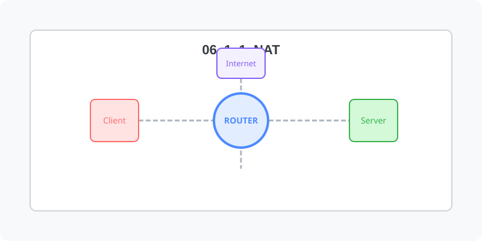

[⬅️ 이전](../) &nbsp;|&nbsp; [🏠 분류 목차](../../../)

# NAT (Network Address Translation)

방대한 주제를 분할하여 제공합니다.

## 1️⃣ 핵심 학습 가이드
* [네트워크 주소 변환](part_1/)

  해당 파트의 상세 내용을 학습합니다.

* [장점](part_2/)

  해당 파트의 상세 내용을 학습합니다.

## 2️⃣ 심화 및 활용 파트 1
* [Port Forwarding](part_3/)

  해당 파트의 상세 내용을 학습합니다.

* [네트워크 인터페이스NIC 디바이스 명명 규칙](part_4/)

  해당 파트의 상세 내용을 학습합니다.

---

[⬅️ 이전](../) &nbsp;|&nbsp; [🏠 분류 목차](../../../)
