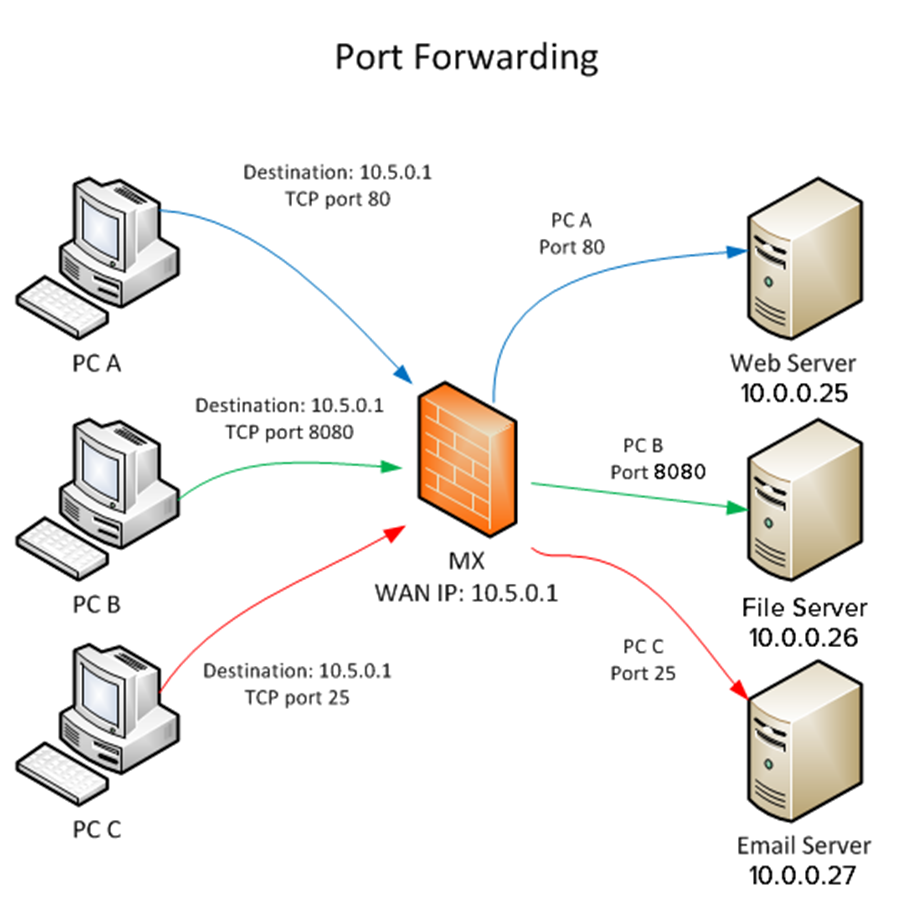
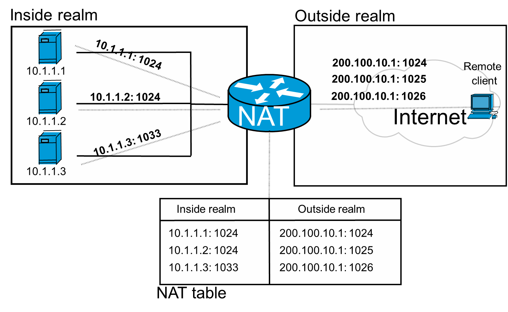

[⬅️ 이전](../) &nbsp;|&nbsp; [🏠 분류 목차](../../../)

# Port Forwarding

## Port Forwarding 
---
[컴퓨터 네트워크](https://ko.wikipedia.org/wiki/컴퓨터_네트워크)에서 [패킷](https://ko.wikipedia.org/wiki/네트워크_패킷)이 [라우터](https://ko.wikipedia.org/wiki/라우터)나 [방화벽](https://ko.wikipedia.org/wiki/방화벽_(네트워킹))과 같은 네트워크 게이트웨이를 가로지르는 동안 하나의 [IP ](https://ko.wikipedia.org/wiki/IP_주소)[주소](https://ko.wikipedia.org/wiki/IP_주소)와 [포트 번호](https://ko.wikipedia.org/wiki/포트_번호) 결합의 통신 요청을 다른 곳으로 넘겨주는 [네트워크 주소 변환](https://ko.wikipedia.org/wiki/네트워크_주소_변환)(NAT)의 응용

* 이 기법은 게이트웨이(외부망)의 반대쪽에 위치한 보호/내부망에 상주하는 호스트에 대한 서비스를 생성하기 위해 흔히 사용

* 통신하는 목적지 IP 주소와 포트 번호를 내부 호스트에 다시 매핑함으로써 이루어진다.

### port forwarding실습 
> VMWare Player

* HOST OS에서 가상 머신 OS로 접속하는 것은 너무 쉽다.

* 내 옆사람의 컴퓨터의 가상머신에 접속해 보자.

> Googling 
> * VMWare player Port forwarding 
> * VMWare player network manager download
> * https://www.tobias-hartmann.net/2018/12/download-vmnetcfg-exe-fuer-vmware-workstation-15-x-player/

* https://togll.tistory.com/26

* https://renesys.tistory.com/144

---

[⬅️ 이전](../)
