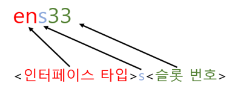

[⬅️ 이전](../) &nbsp;|&nbsp; [🏠 분류 목차](../../../)

# 네트워크 인터페이스NIC 디바이스 명명 규칙

## 네트워크 인터페이스(NIC) 디바이스 명명 규칙
---

### 명명 규칙을 만든 이유

* 여러 개의 네트워크 카드를 동시에 사용하는 일이 많아 지면서 체계화된 명명 규칙 필요.

* 통신방법에 따른 분류, 슬롯 종류에 따른 분류

* 이전엔 eth0,eth1, 이런식으로 명명

* OS의 Systemd에 의해 결정

### 디바이스명 명명 규칙

* 앞의 두자리 'en'의 경우 인터페이스 타입을 뜻합니다.
  - en – 이더넷
  - wl - 무선 LAN
  - ww - 무선 WAN

* 슬롯별 설정
  - s33은 BIOS에서 PCI express 핫 플러그 슬롯 인덱스 번호(여기서는 33)를 제공할때 사용됩니다.

---

[⬅️ 이전: CentOS에서 ICMP 패킷을 허용](../06_1_13_icmp/) &nbsp;|&nbsp; [🏠 분류 목차](../../../) &nbsp;|&nbsp; [다음: Virtualbox ➡️](virtualbox/)

---

[⬅️ 이전](../)
