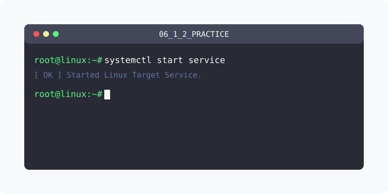
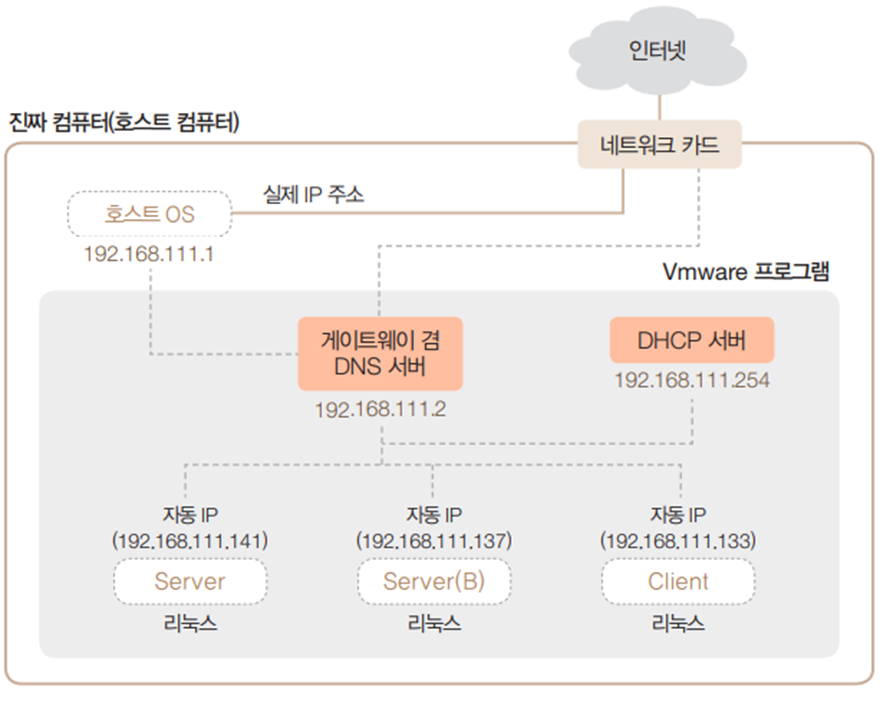
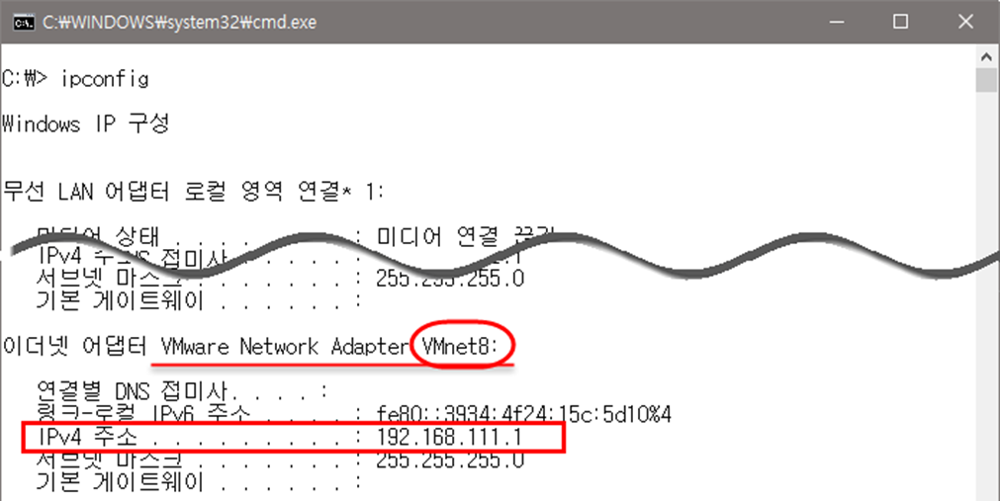

[⬅️ 이전](../) &nbsp;|&nbsp; [🏠 분류 목차](../../../)

# 네트워크 정보 파악

### 설정된 네트워크 환경

* 호스트 OS에는 가상 IP 192.168.111.1이 자동으로 할당

* 호스트 OS에는 실제로 사용하는 별도의 IP 주소 존재

* 192.168.111.2는 게이트웨이와 DNS 서버 역할을 모두 하는 가상 장치의 IP 주소

* 192.168.111.254는 DHCP 서버 역할을 하는 가상의 주소

* Server, Server(B), Client는 모두 자동으로 IP를 할당받도록 설정됨

* 이 IP 정보는 가상 DHCP 서버(192.168.111.254)에서 할당받음

### 네트워크 관련 정보

* 가상머신에 인터넷을 연결하려면 각 가상머신에 네트워크 관련 정보를 입력해야 함

* 네트워킹이 정상적으로 이루어지려면 각 가상머신(게스트 OS)에 IP 주소, 서브넷 마스크(subnet mask), 게이트웨이(gateway) 주소, DNS(Domain Name System) 서버 주소 입력

### VMWare 네트워크 정보 확인
* 윈도우에서 `cmd`로 명령 프롬프트가 실행, ipconfig 명령 실행
* 'Vmware Network Adapter VMnet8’ 부분 확인

방대한 주제를 분할하여 제공합니다.

## 1️⃣ 핵심 학습 가이드
* [실습1 가상머신에 할당된 IP주소 확인하기](part_1/)

  해당 파트의 상세 내용을 학습합니다.

* [네트워크 설정과 명령](part_2/)

  해당 파트의 상세 내용을 학습합니다.

* [실습2  고정 IP 주소 변경하기](part_3/)

  해당 파트의 상세 내용을 학습합니다.

## 2️⃣ 심화 및 활용 파트 1
* [실습 고정 IP 주소 변경하기](part_4/)

  해당 파트의 상세 내용을 학습합니다.

* [시스템 설정](part_5/)

  해당 파트의 상세 내용을 학습합니다.

* [실습3  Host OS network 파악](part_6/)

  해당 파트의 상세 내용을 학습합니다.

## 3️⃣ 심화 및 활용 파트 2
* [실습 가상머신 네트워크 확인](part_7/)

  해당 파트의 상세 내용을 학습합니다.

* [실습 가상머신 네트워크 확인](part_8/)

  해당 파트의 상세 내용을 학습합니다.

## 3️⃣ 심화 및 활용 파트 2
---

[⬅️ 이전](../) &nbsp;|&nbsp; [🏠 분류 목차](../../../)
