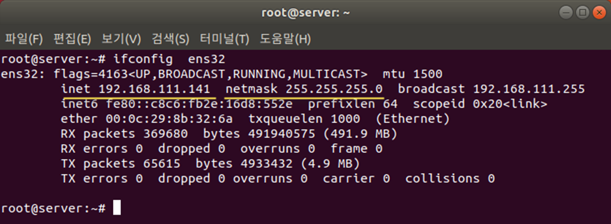
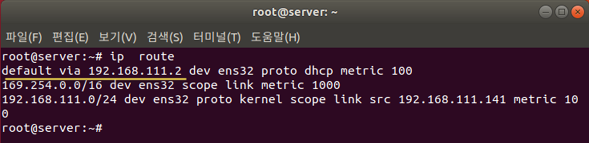
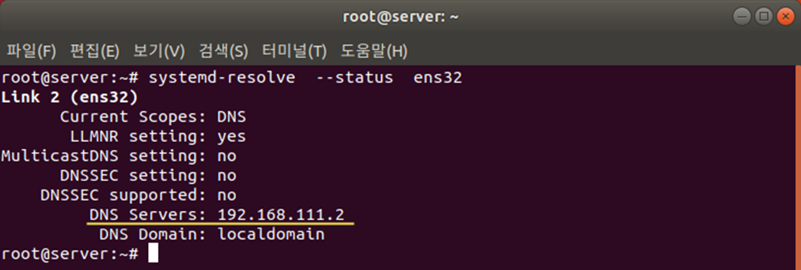

[⬅️ 이전](../) &nbsp;|&nbsp; [🏠 분류 목차](../../../)

# 실습1 가상머신에 할당된 IP주소 확인하기

## 실습1: 가상머신에 할당된 IP주소 확인하기

가상머신 부팅하기

할당된 IP 주소 확인하기

* 각각의 터미널을 열고 ifconfig 명령 입력
* ifconfig 명령어가 없는경우 : 
       apt-get install net-tools
* 현재 할당된 IP 주소 확인(컴퓨터 환경에 따라 다름) 

게이트웨이 정보 확인하기

* 현재 설정된 게이트웨이의 정보는 ip route 명령으로 확인 가능

* 현재 설정된 DNS 서버의 정보는 systemd-resolve --status ens32 명령으로 확인 가능

---

[⬅️ 이전](../)
