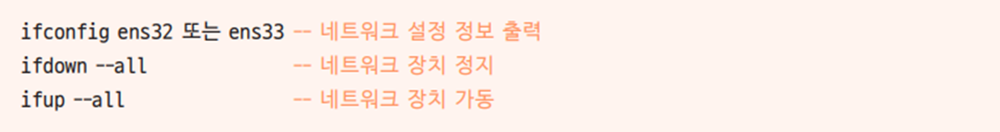
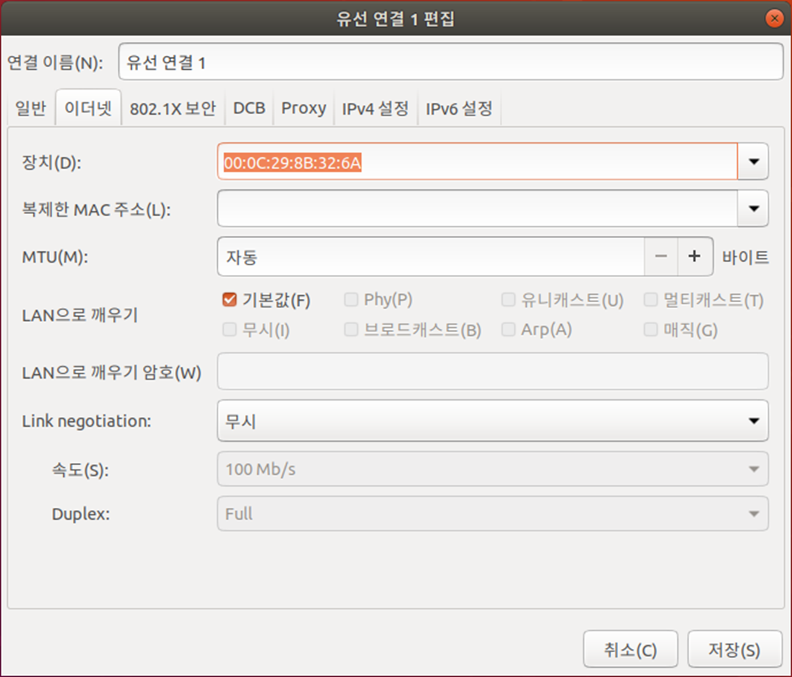

[⬅️ 이전](../) &nbsp;|&nbsp; [🏠 분류 목차](../../../)

# 네트워크 설정과 명령

## 네트워크 설정과 명령

리눅스에서의 네트워크 장치 이름

- 리눅스에 랜 카드가 장착되면 Ubuntu 18.04 LTS는 자동으로 이 장치의 이름을 ens32 또는 ens33으로 인식

- 랜 카드의 이름은 네트워크 정보를 파악하거나 네트워크를 정지 또는 가동할 때 이용

nm-connection-editor

* nm은 Network Manager의 약자

* 네트워크와 관련된 작업은 대부분 이 명령어를 바탕으로 실행 가능

* nm-connection-editor 명령으로 설정하는 사항은 아래와 같음
  - 자동 IP 주소 또는 고정 IP 주소 사용 결정
  - IP 주소, 서브넷 마스크, 게이트웨이 정보 입력
  - DNS 정보 입력
  - 네트워크 카드 드라이버 설정
  - 네트워크 장치(ens32 또는 ens33) 설정

systemctl start/stop/restart/status networking

* 네트워크의 설정을 변경한 후 변경된 내용을 시스템에 적용하는 명령

 → nm-connection-editor 명령을 실행하여 내용을 변경한 후에는 반드시 systemctl restart 

   networking 명령을 실행하는 것

* restart 옵션은 stop과 start 옵션이 합쳐진 것

* status 옵션은 현재 작동(active) 또는 정지(inactive) 상태를 나타냄

ifconfig 장치명

* 해당 장치의 IP 주소와 관련 정보를 출력하는 명령어

nslookup

* DNS 서버의 작동을 테스트하는 명령어

ping IP 주소 또는 URL

* 해당 컴퓨터가 네트워크상에서 응답하는지 테스트하는 간편한 명령어

* 상대 컴퓨터가 네트워크상에서 아무 이상 없이 작동되는지 확인할 때 주로 사용

### /etc/resolv.conf

* DNS 서버의 정보와 호스트 이름이 들어 있는 파일

* 임시로 사용되는 파일이며 네트워크를 재시작하면 초기화됨

---

[⬅️ 이전](../)
