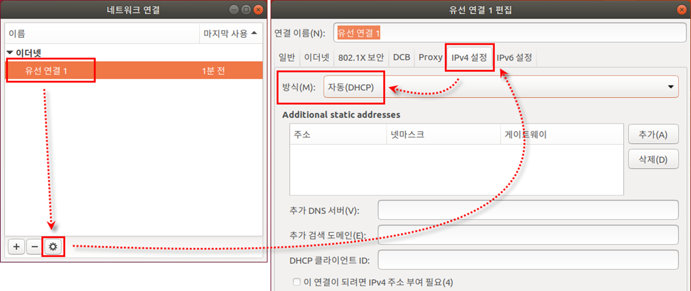

[⬅️ 이전](../) &nbsp;|&nbsp; [🏠 분류 목차](../../../)

# 실습2  고정 IP 주소 변경하기

## 실습2 : 고정 IP 주소 변경하기

터미널 열기

IP 정보 확인하기

* nm-connection-editor 명령 입력
* [네트워크 연결] 창이 나타나면 설정된 네트워크 정보를 확인

​    장치의 이름은 ‘유선 연결 1’이며, 현재는 IP 주소를 자동으로 할당받도록 되어 있음

---

[⬅️ 이전](../)
