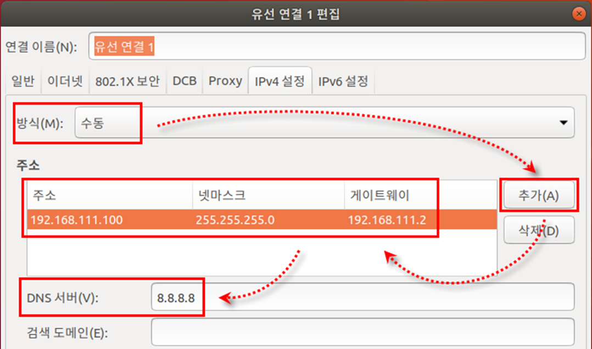
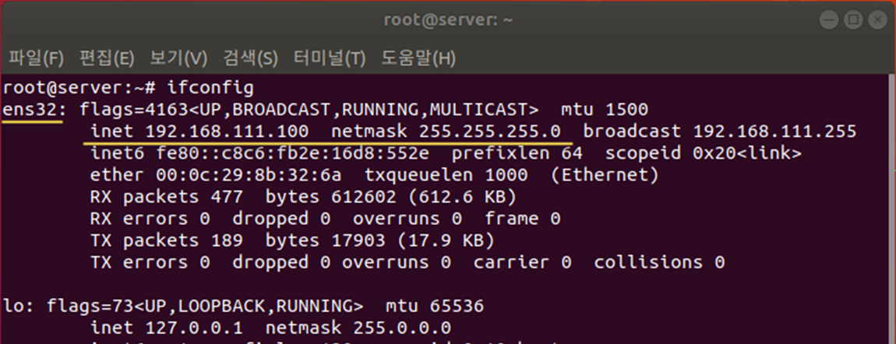
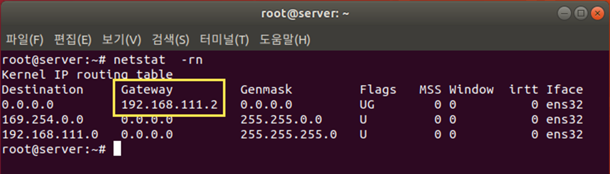
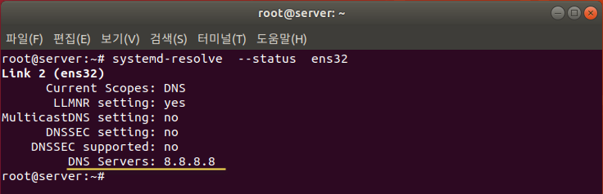

[⬅️ 이전](../) &nbsp;|&nbsp; [🏠 분류 목차](../../../)

# 실습 고정 IP 주소 변경하기

## 실습: 고정 IP 주소 변경하기 

고정 IP로 설정 변경하기

* 방식을 ‘수동’으로 변경하고 <추가> 클릭

​    주소에는 ‘192.168.○○○.100’, 넷마스크에는 ‘255.255.255.0’, 

​    게이트웨이에는 ‘192.168.○○○.2’ 입력

​    이때 [그림 4-1]에서 확인한 자기 컴퓨터의 숫자를 ○○○에 넣어야 함

​    DNS 서버에는 ‘8.8.8.8’ 입력

  3-2 <저장> 클릭, 입력 내용을 저장하고 [네트워크 연결] 창 닫기

  3-3 설정을 적용하기 위해 터미널에서 reboot 명령으로 컴퓨터 재부팅

고정 IP로 설정된 내용 확인하기

  4-1 바탕화면에서 마우스 오른쪽 버튼을 클릭하여 [터미널 열기] 선택

  4-2 변경한 설정 내용이 적용된 것을 ifconfig 명령으로 확인

netstat -rn 명령으로 게이트웨이 확인

설정된 DNS 서버 정보를 systemd-resolve --status ens32 명령으로 확인

---

[⬅️ 이전](../)
