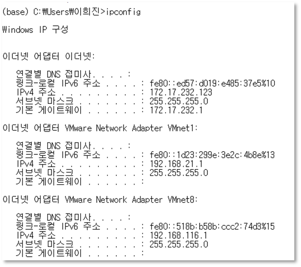

[⬅️ 이전](../) &nbsp;|&nbsp; [🏠 분류 목차](../../../)

# 실습3  Host OS network 파악

## 실습3 : Host OS network 파악

Windows network

```
이더넷 어댑터 이더넷
IPv4 주소 : 172.17.232.123

이더넷 어댑터 Vmware Network Adapter VMnet1
IPv4 주소 : 192.168.21.1

이더넷 어댑터 Vmware Network Adapter VMnet8
IPv4 주소 : 192.168.116.1

```




---

[⬅️ 이전](../)
