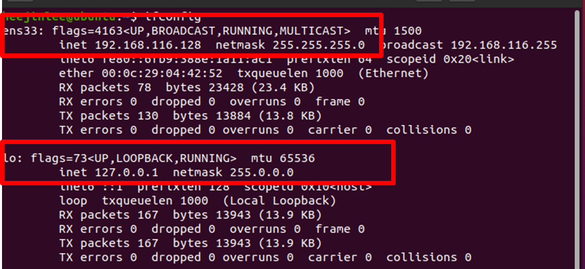

[⬅️ 이전](../) &nbsp;|&nbsp; [🏠 분류 목차](../../../)

# 실습 가상머신 네트워크 확인

## 실습: 가상머신 네트워크 확인

### 2개 결과 

ens33: 

 inet 192.168.116.128 

lo : 

 inet 127.0.0.1

### 127.0.0.1 -> 사용중인 컴퓨터의 지칭하는 ip

---

[⬅️ 이전](../)
