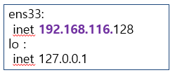

[⬅️ 이전](../) &nbsp;|&nbsp; [🏠 분류 목차](../../../)

# 실습 가상머신 네트워크 확인

## 실습: 가상머신 네트워크 확인
```
이더넷 어댑터 이더넷 => 이건 실제 pc ip 
IPv4 주소 : 172.17.232.123

이더넷 어댑터 Vmware Network Adapter VMnet1
IPv4 주소 : 192.168.21.1

이더넷 어댑터 Vmware Network Adapter VMnet8
IPv4 주소 : 192.168.116.1

```



Host OS(windows) ip와 Guest OS (가상머신) ip의 subnet이 같은것 

* 192.168.116.x è Vmware Network Adapter VMnet8에 연결됨

* VMnet8은 뭐지? 
  - VMWare에서 설정한 network 중에 8번 network 

* 가상머신의 network는 어떻게 설정 되어 있는가?  è NAT

* NAT 설정이면 8번 network를 사용한다. 

---

[⬅️ 이전: Vmware](../06_1_1_nat/vmware/) &nbsp;|&nbsp; [🏠 분류 목차](../../../) &nbsp;|&nbsp; [다음: 네트워크 재시작 ➡️](../06_1_3_restart/)


---

[⬅️ 이전](../)
