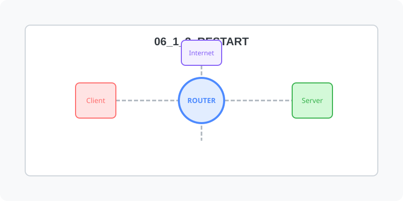

[⬅️ 이전: 네트워크 정보 파악](../06_1_2_practice/) &nbsp;|&nbsp; [🏠 분류 목차](../../../) &nbsp;|&nbsp; [다음: 네트워크 재시작 (centos) ➡️](centos/)

# 네트워크 재시작
리눅스에서 네트워크 IP를 변경하면 네트워크를 재시작하여야 합니다. 각 배포판마다 네트워크를 재시작 하는 방법은 약간씩 차이가 있습니다. 

* [우분투](./ubuntu/)
* [centos](./centos/)

---

[⬅️ 이전: 네트워크 정보 파악](../06_1_2_practice/) &nbsp;|&nbsp; [🏠 분류 목차](../../../) &nbsp;|&nbsp; [다음: 네트워크 재시작 (centos) ➡️](centos/)
