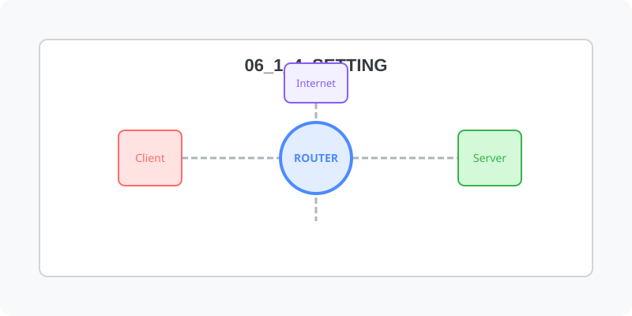

[⬅️ 이전: 네트워크 재시작(우분투)](../06_1_3_restart/ubuntu/) &nbsp;|&nbsp; [🏠 분류 목차](../../../) &nbsp;|&nbsp; [다음: TCP/IP ➡️](../06_1_5_tcp/)



# 네트웍 설정

## 고정 아이피 변경

Rocky
```
$ cd /etc/NetworkManager/system-connections
$ ls
ens160.nmconnection

$ gedit ens160.nmconnection
```

현재 네트워크 설정은 dhcp를 통하여 자동으로 받아고 있습니다.
```ini
[ipv4]
method=auto
```

```ini
[ipv4]
method=manual
address1=192.168.111.100/24, 192.168.111.2
dns=192.168.111.2
```

재부팅하여 적용합니다.
```
reboot
```

---

[⬅️ 이전: 네트워크 재시작(우분투)](../06_1_3_restart/ubuntu/) &nbsp;|&nbsp; [🏠 분류 목차](../../../) &nbsp;|&nbsp; [다음: TCP/IP ➡️](../06_1_5_tcp/)
