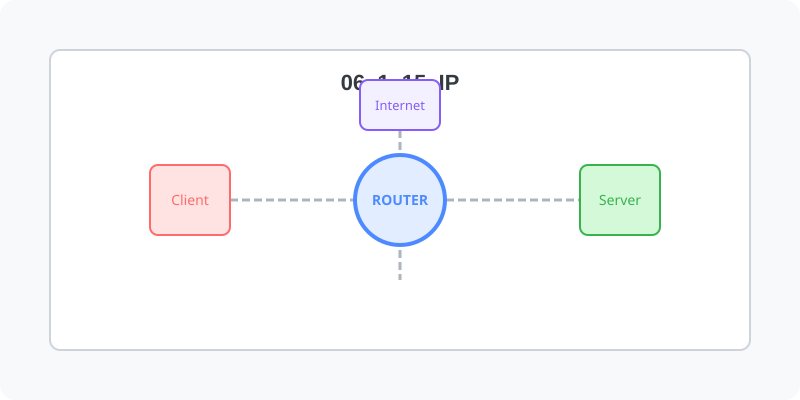

[⬅️ 이전](../) &nbsp;|&nbsp; [🏠 분류 목차](../../../)

# IP주소
네트워크상에 연결된 컴퓨터를 유일하게 구분하는 번호 체계입니다.

방대한 주제를 분할하여 제공합니다.

## 1️⃣ 핵심 학습 가이드
* [IP주소란](part_1/)

  해당 파트의 상세 내용을 학습합니다.

* [IP 주소의 종류](part_2/)

  해당 파트의 상세 내용을 학습합니다.

## 2️⃣ 심화 및 활용 파트 1
* [IP 주소 체계](part_3/)

  해당 파트의 상세 내용을 학습합니다.

* [특수 용도의 IP](part_4/)

  해당 파트의 상세 내용을 학습합니다.

## 3️⃣ 심화 및 활용 파트 2
* [실습](part_5/)

  해당 파트의 상세 내용을 학습합니다.

## 3️⃣ 심화 및 활용 파트 2
---

[⬅️ 이전](../) &nbsp;|&nbsp; [🏠 분류 목차](../../../)
