[⬅️ 이전](../) &nbsp;|&nbsp; [🏠 분류 목차](../../../)

# 1. 텔넷 Telnet 통신의 문제점

## 1. 텔넷 (Telnet) 통신의 문제점
네트워크 초창기 유닉스 시절부터 쓰이던 가장 단순무식하게 원격을 연결해 주는 역사적인 첫 접속 프로토콜입니다.

### 1.1 텔넷의 평문 구조 한계
* **치명적인 보안 위협**: 텔넷은 아이디와 비밀번호를 칠 때 아무런 '암호 잠금' 처리를 하지 않고 **텍스트 그대로(평문) 인터넷 선 위로 던집니다**. 누군가 중간에 패킷을 가로채서 까보기만 해도 최고 관리자 암호가 그대로 노출되는 최악의 단점이 있습니다.
* 요즘 기업 실무나 자격증 등에서는 텔넷을 절대 쓰지 않도록 강하게 규칙으로 정해 두고 있습니다. 

*(기존 텔넷 동작 원리 및 아키텍처 슬라이드)*
> 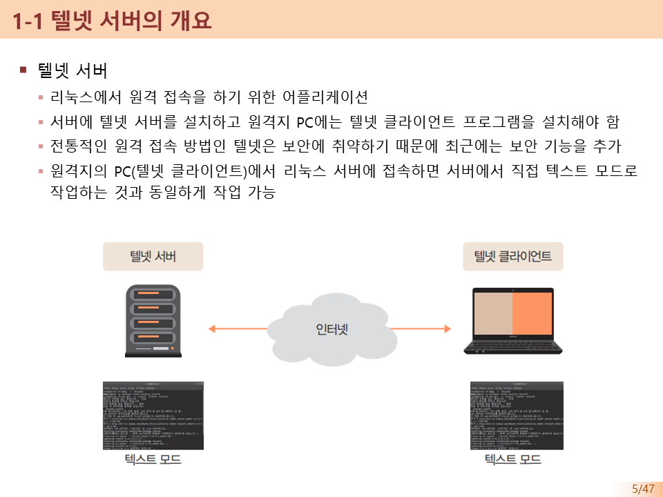
> 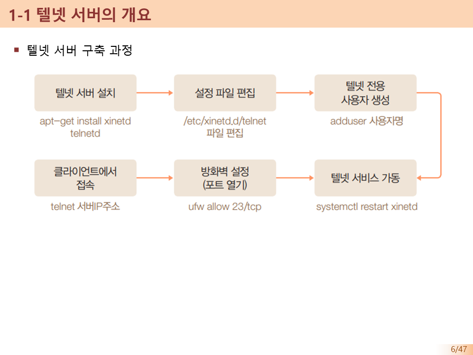
> 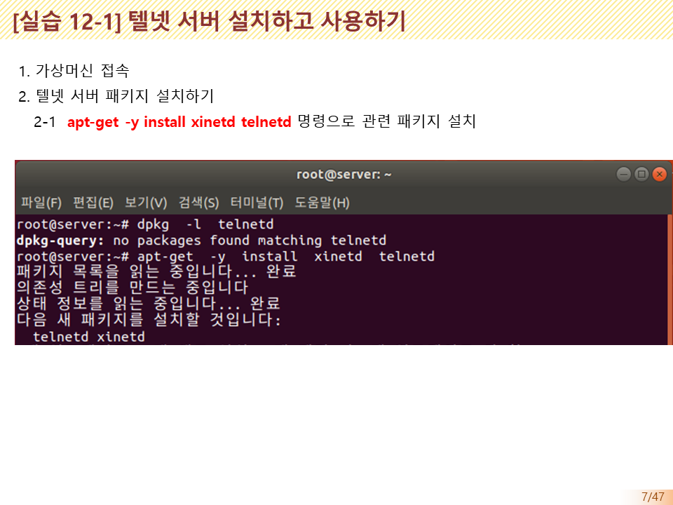
> 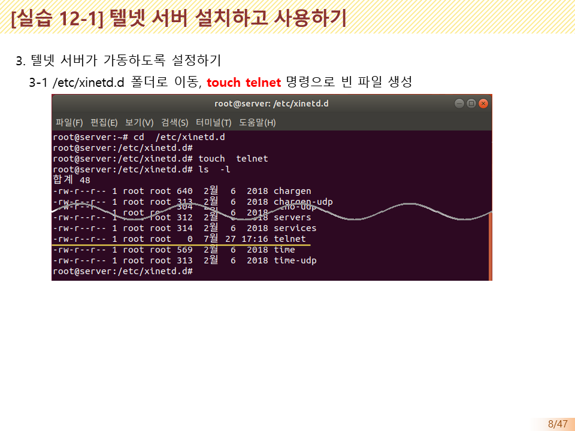
> 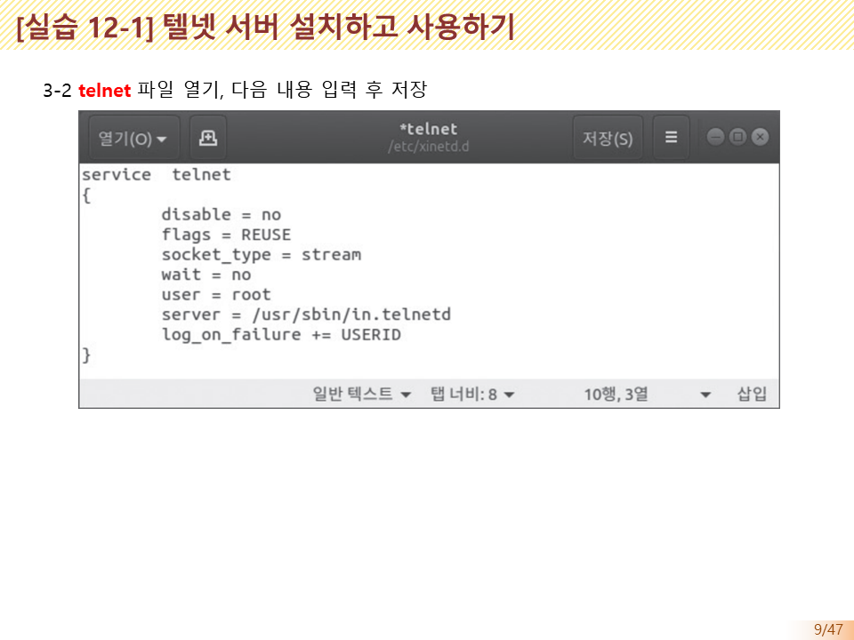
> 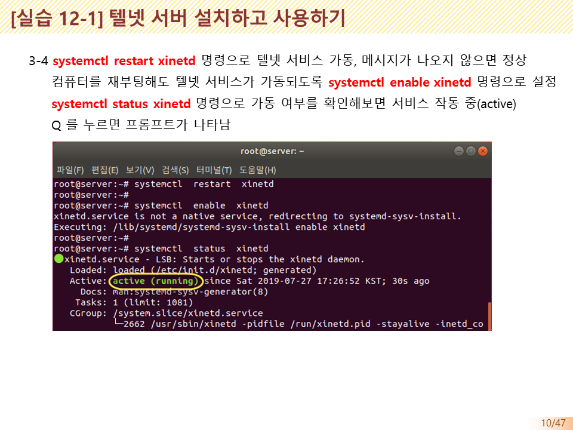
> 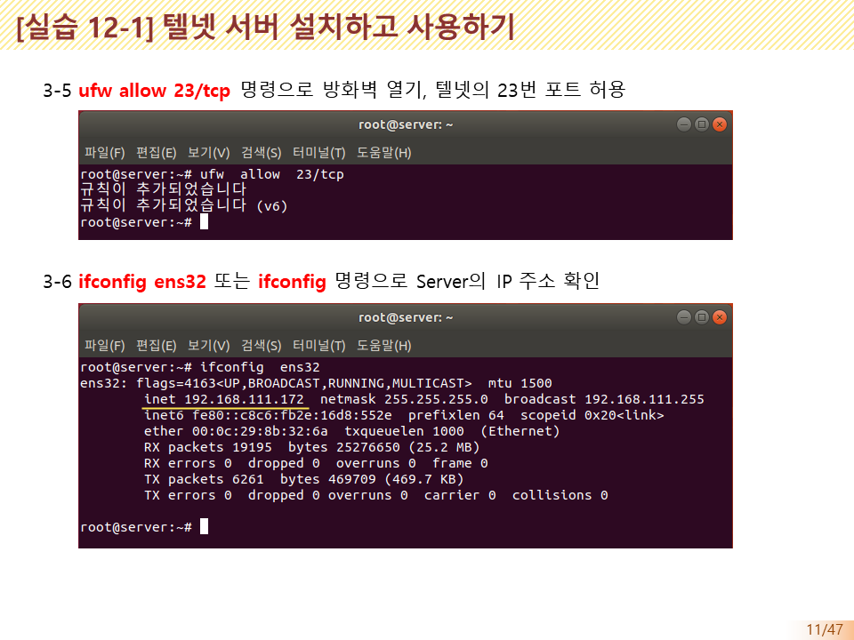
> 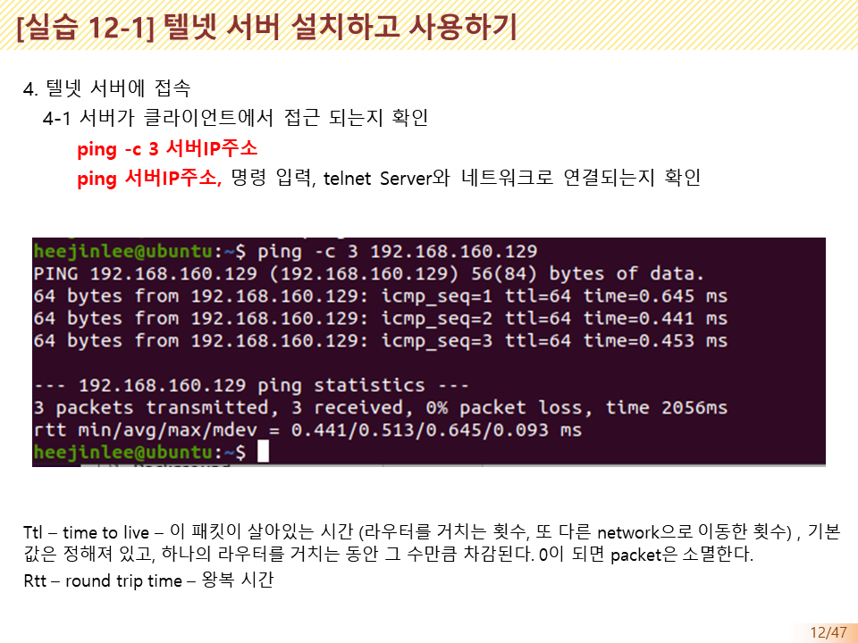
> 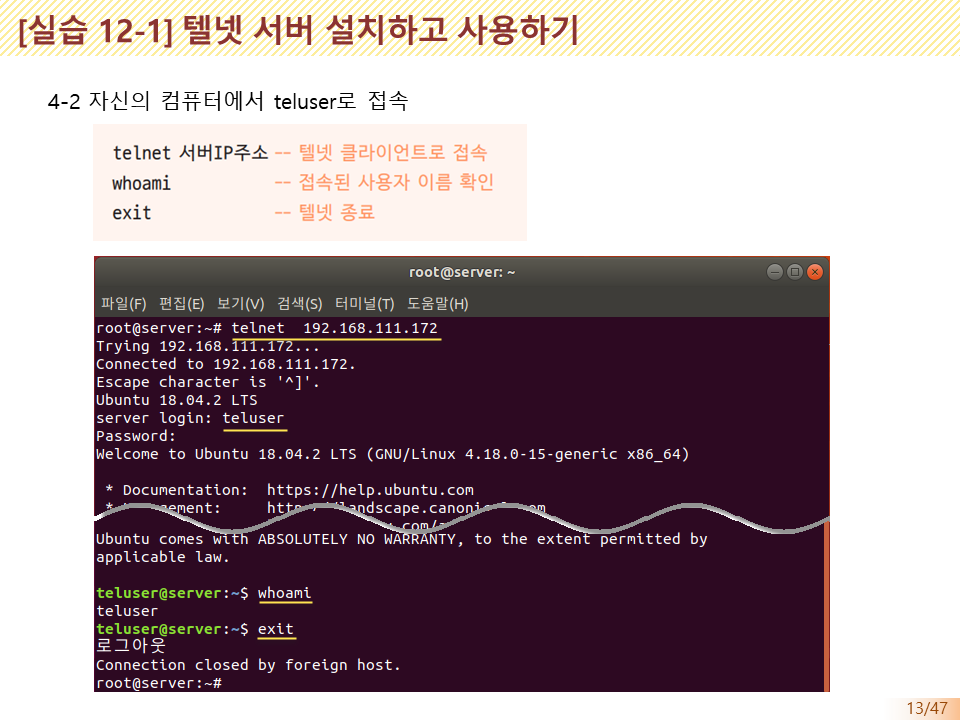
> 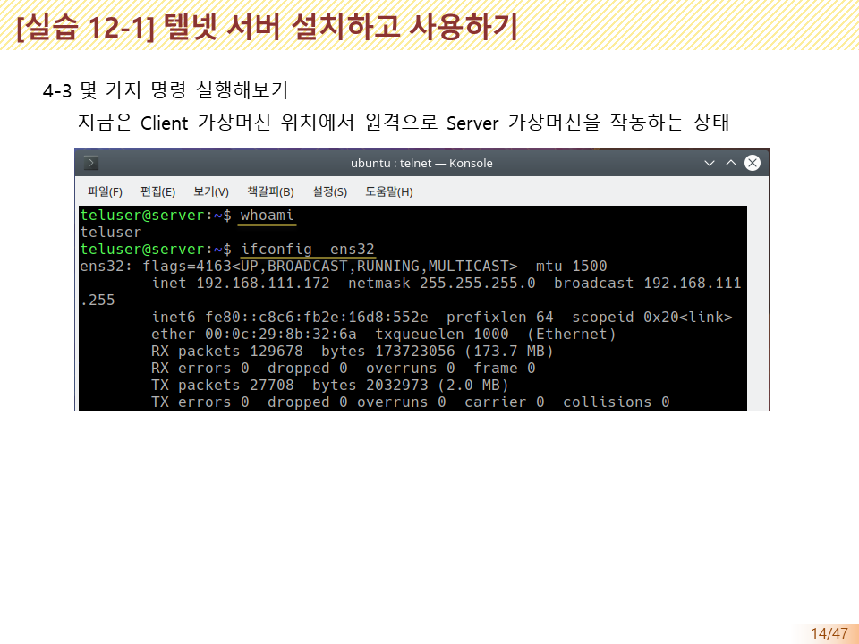
> 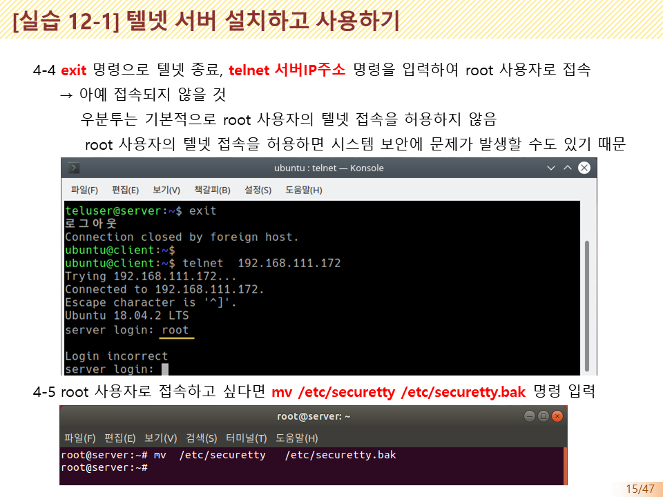
> 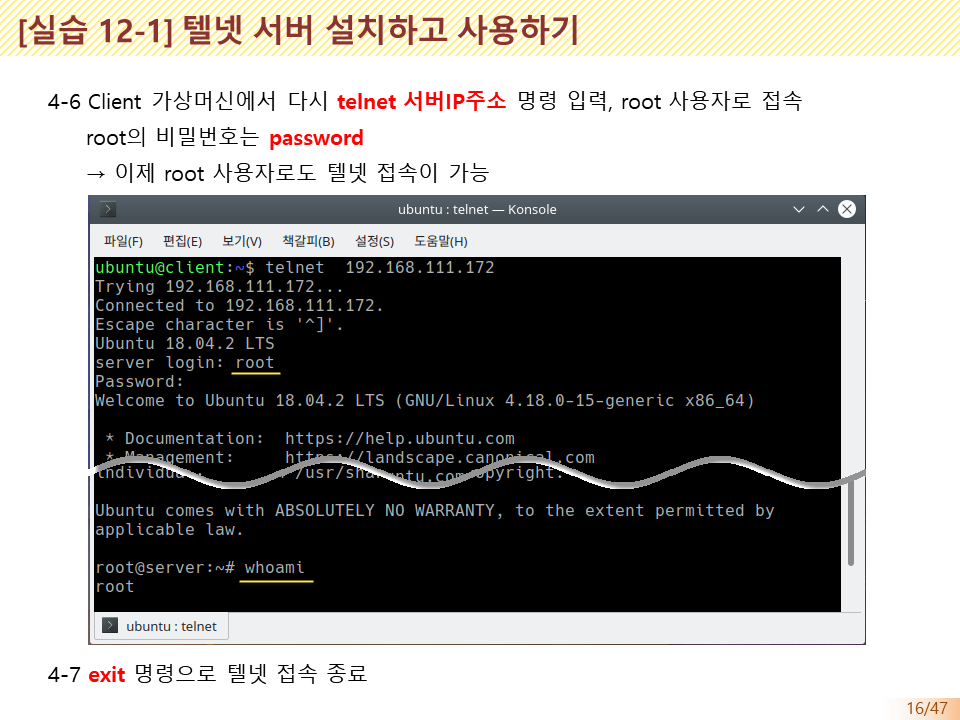

---

---

[⬅️ 이전](../)
