[⬅️ 이전](../) &nbsp;|&nbsp; [🏠 분류 목차](../../../)

# 2. 보안 원격 접속 SSH Secure Shell의 등장

## 2. 보안 원격 접속, SSH (Secure Shell)의 등장
구형 텔넷의 끔찍한 보안 수준을 혁신하기 위해 통신 터널 전체를 강력한 RSA/Ed25519 공개키 방식으로 겹겹이 랩핑하여 묶어버리는 철통 보안 프로토콜입니다.

### 2.1 SSH의 특장점
* **암호화 통신**: 지금 내 컴퓨터와 지구 반대편 서버 사이에서 왔다 갔다 하는 모든 통신 타이핑 글씨들이 전부 암호 연산 모듈에 의해 섞여서 날아갑니다. 중간에 누가 선을 뜯어서 까보아도 해독이 불가능합니다.
* **현재의 무조건적인 국제 표준**: 여러분이 다루게 될 AWS, 구글 클라우드, 사내 물리장비 등 모든 접속은 오로지 이 SSH 22번 포트 규약을 통해 이루어집니다. `Putty`, `MobaXterm`, `Mac 터미널` 등 모든 곳에서 쓰입니다.

*(기존 보안 쉘(SSH) 암호화 구조 원리 슬라이드)*
> 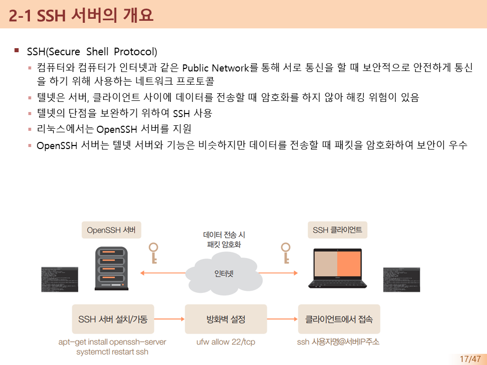
> 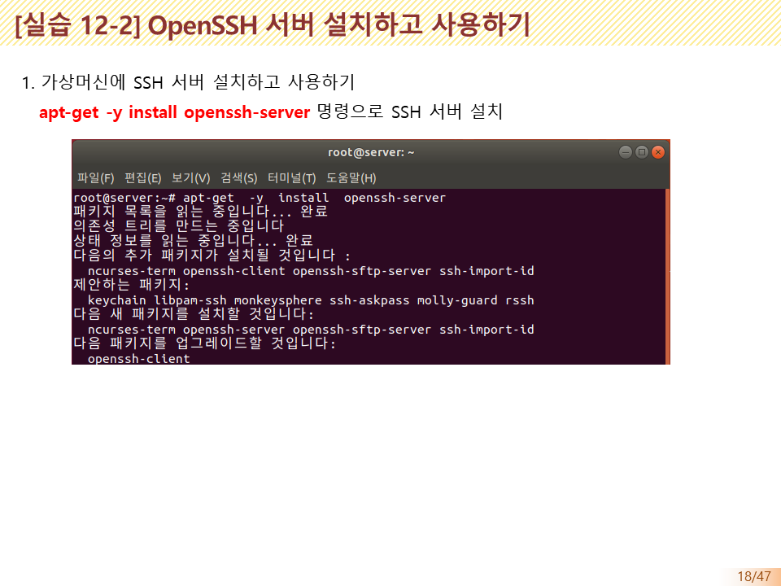
> 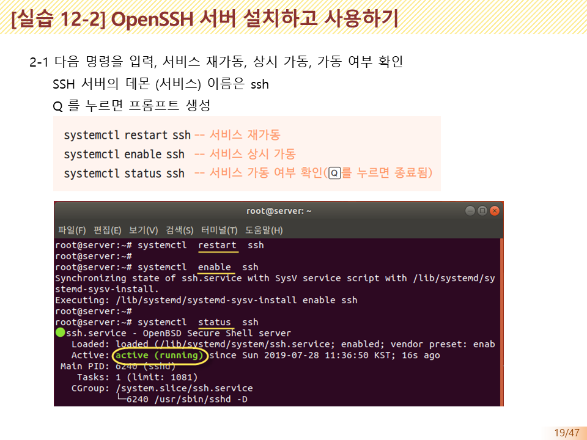
> 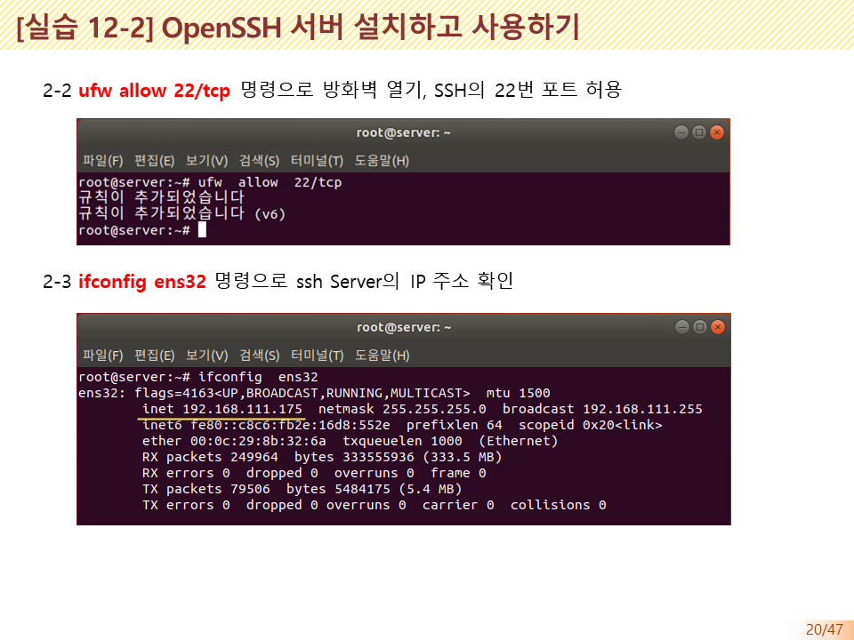
> 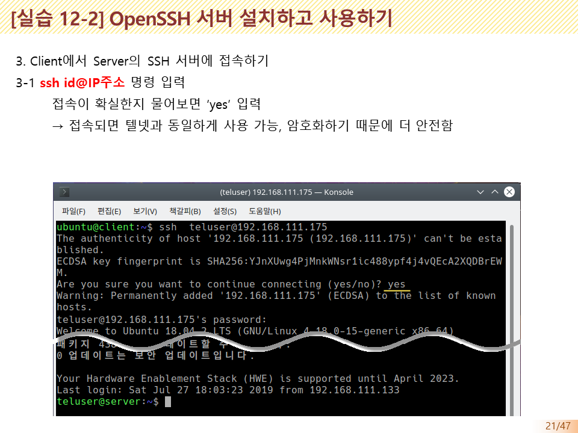
> 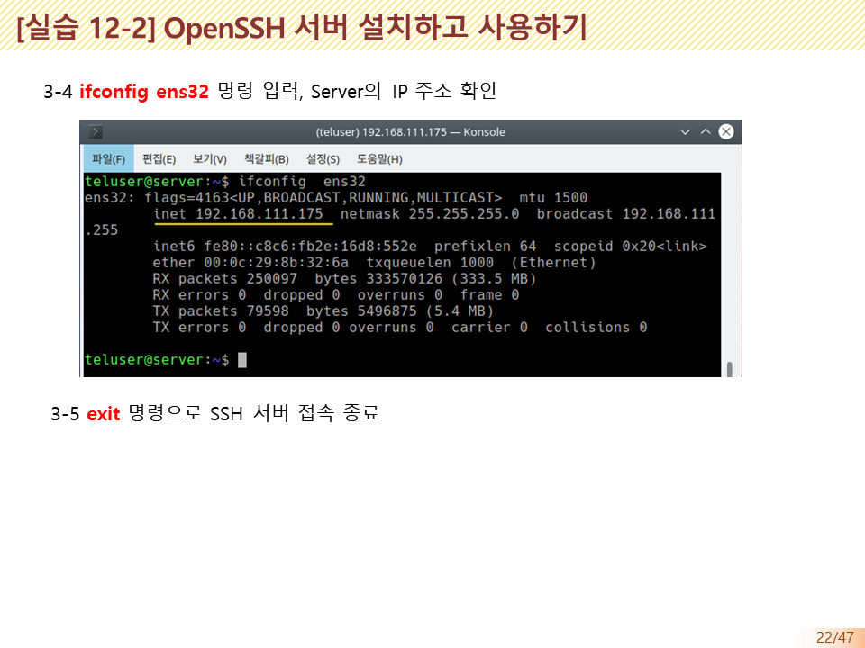
> 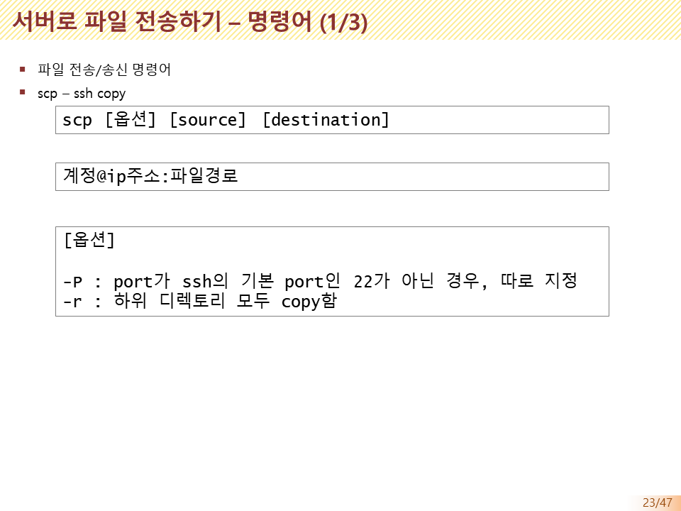
> 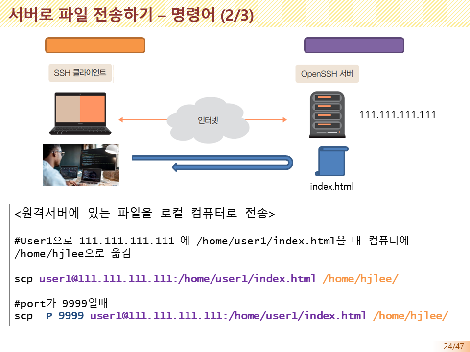
> 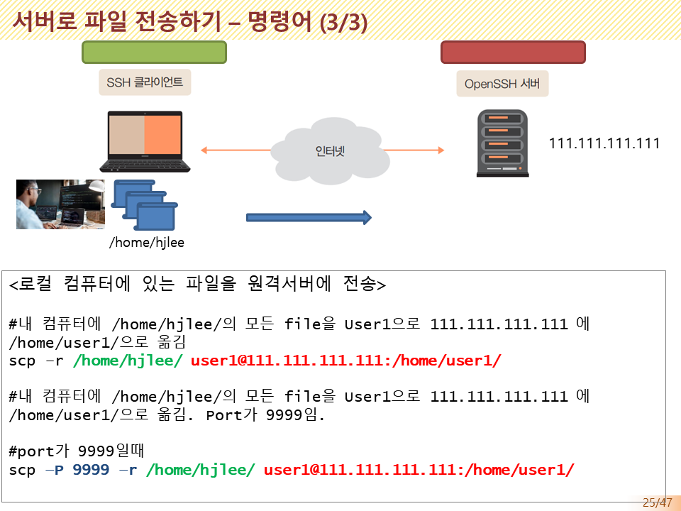
> 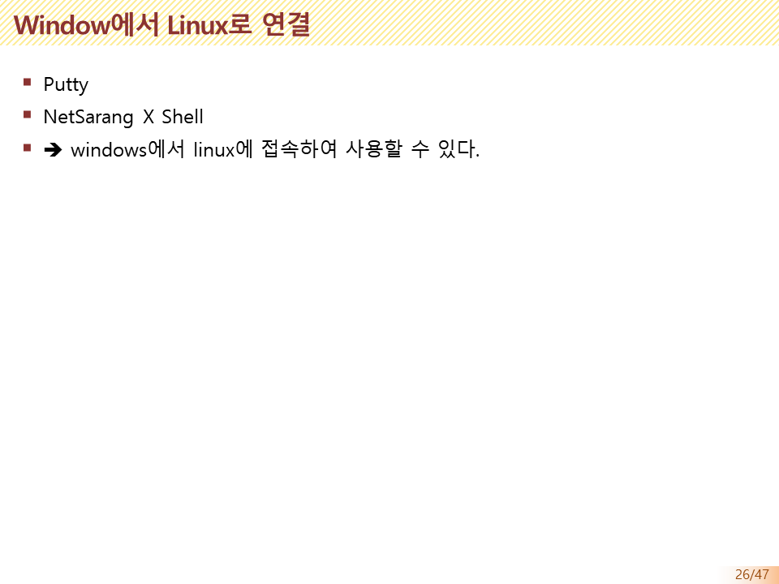
> 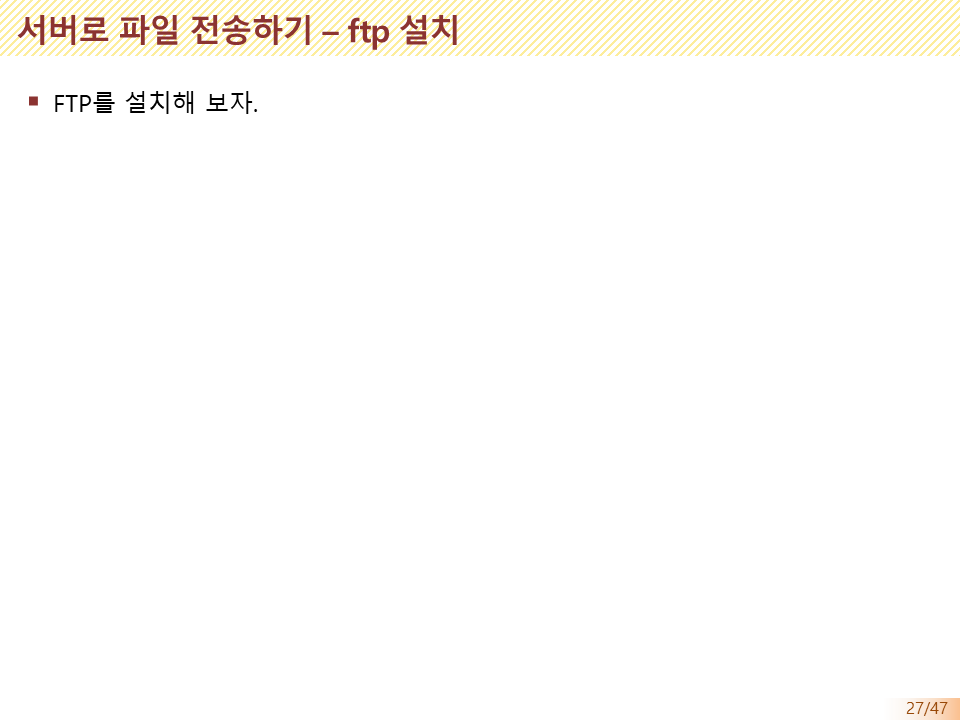

---

---

[⬅️ 이전](../)
