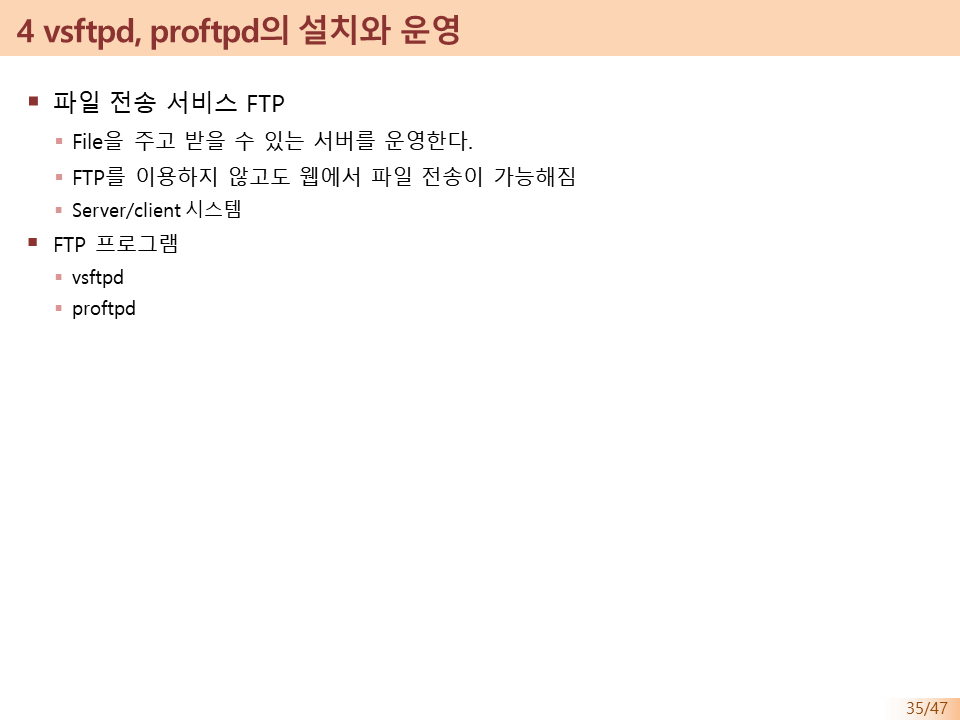

[⬅️ 이전](../) &nbsp;|&nbsp; [🏠 분류 목차](../../../)

# 3. GUI 그래픽 원격 화면 VNC 서버 개요

## 3. GUI 그래픽 원격 화면, VNC 서버 개요
까만 텍스트 화면 대신 윈도우 원격 데스크톱 연결이나 팀뷰어(TeamViewer)처럼 우분투 바탕화면 마우스 환경을 통째로 모니터로 떠오게 해주는 시스템입니다. VNC 뷰어를 통해 통신합니다.

*(VNC 화면 출력 방식 슬라이드)*
> 

---

---

[⬅️ 이전](../)
