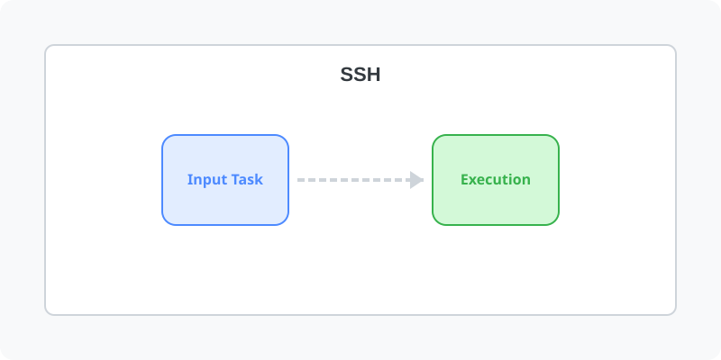

[⬅️ 이전: 9.3 원격 접속 환경 관리](../../) &nbsp;|&nbsp; [🏠 분류 목차](../../../../) &nbsp;|&nbsp; [다음: Netstat -ntlp ➡️](../../06_4_2_netstat/)

# 시작 기본기

패키지 설치확인 

rpm -qa | grep ssh

실행여부 확인

ps -ef | grep ssh

---

[⬅️ 이전: 9.3 원격 접속 환경 관리](../../) &nbsp;|&nbsp; [🏠 분류 목차](../../../../) &nbsp;|&nbsp; [다음: Netstat -ntlp ➡️](../../06_4_2_netstat/)
