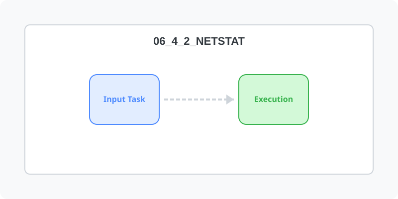
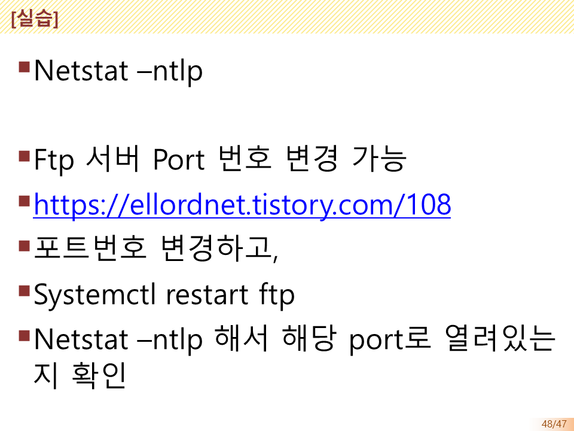

[⬅️ 이전: 시작 기본기](../06_4_1__remote/ssh/) &nbsp;|&nbsp; [🏠 분류 목차](../../../) &nbsp;|&nbsp; [다음: putty 다운로드 및 설치 ➡️](../06_4_3_putty/)

# Netstat -ntlp

---

[⬅️ 이전: 시작 기본기](../06_4_1__remote/ssh/) &nbsp;|&nbsp; [🏠 분류 목차](../../../) &nbsp;|&nbsp; [다음: putty 다운로드 및 설치 ➡️](../06_4_3_putty/)
