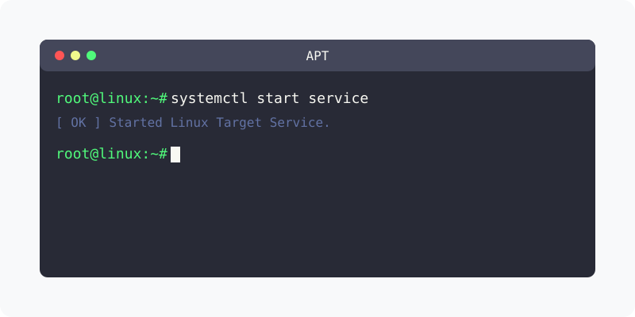

[⬅️ 이전](../) &nbsp;|&nbsp; [🏠 분류 목차](../../../)

# 우분투 에서 OpenSSH 설치하기

방대한 주제를 분할하여 제공합니다.

## 1️⃣ 핵심 학습 가이드
* [방화벽 설정](part_1/)

  해당 파트의 상세 내용을 학습합니다.

* [포트 포워딩 설정](part_2/)

  해당 파트의 상세 내용을 학습합니다.

## 2️⃣ 심화 및 활용 파트 1
* [OpenSSH 설치하기](part_3/)

  해당 파트의 상세 내용을 학습합니다.

* [방화벽 허용](part_4/)

  해당 파트의 상세 내용을 학습합니다.

## 3️⃣ 심화 및 활용 파트 2
* [03.root 접속 허용](part_5/)

  해당 파트의 상세 내용을 학습합니다.

## 3️⃣ 심화 및 활용 파트 2
---

[⬅️ 이전](../) &nbsp;|&nbsp; [🏠 분류 목차](../../../)
