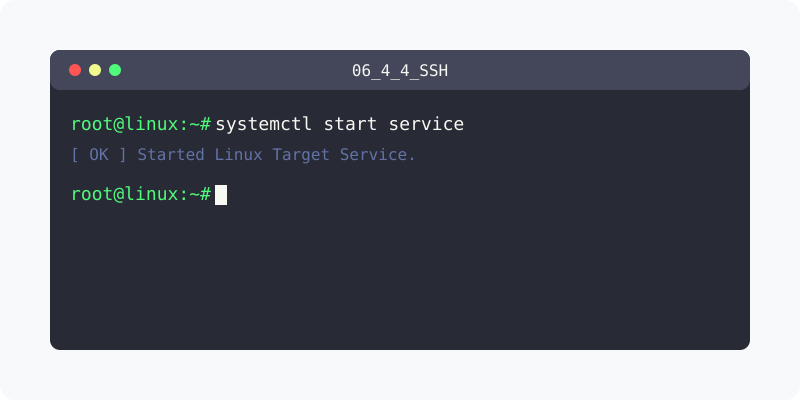

[⬅️ 이전](../) &nbsp;|&nbsp; [🏠 분류 목차](../../../)

# SSH
telnet과 동일한 역할을 히는 프로그램으로 보안이 강화된 방식으로 접속하는 방법입니다.

## 1️⃣ 핵심 학습 가이드
방대한 주제를 분할하여 제공합니다.

* [SSH란](part_1/)

  해당 파트의 상세 내용을 학습합니다.

* [ssh 설치하기](part_2/)

  해당 파트의 상세 내용을 학습합니다.

* [클라이언트 접속](part_3/)

  해당 파트의 상세 내용을 학습합니다.

---

[⬅️ 이전](../) &nbsp;|&nbsp; [🏠 분류 목차](../../../)
