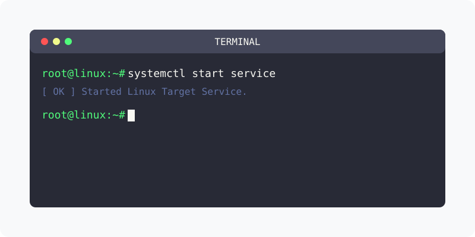

[⬅️ 이전](../) &nbsp;|&nbsp; [🏠 분류 목차](../../../)

# 원격터미널 접속
ssh로 터미널 접속을 하기 위해서는 전용 프로그램이 필요 합니다.

## 1️⃣ 핵심 학습 가이드
방대한 주제를 분할하여 제공합니다.

* [01.Putty 사용하기](part_1/)

  해당 파트의 상세 내용을 학습합니다.

* [02.Moba Xterm 사용하기](part_2/)

  해당 파트의 상세 내용을 학습합니다.

---

[⬅️ 이전](../) &nbsp;|&nbsp; [🏠 분류 목차](../../../)
