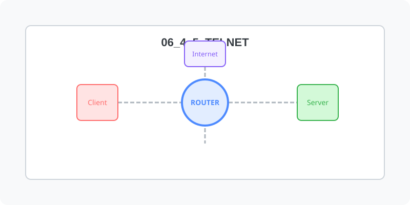

[⬅️ 이전](../) &nbsp;|&nbsp; [🏠 분류 목차](../../../)

# 텔렛

방대한 주제를 분할하여 제공합니다.

## 1️⃣ 핵심 학습 가이드
* [텔렛이란](part_1/)

  해당 파트의 상세 내용을 학습합니다.

* [xinetd 설치](part_2/)

  해당 파트의 상세 내용을 학습합니다.

## 2️⃣ 심화 및 활용 파트 1
* [telnet 설치](part_3/)

  해당 파트의 상세 내용을 학습합니다.

* [설정](part_4/)

  해당 파트의 상세 내용을 학습합니다.

## 3️⃣ 심화 및 활용 파트 2
* [텔넷 클라이언트](part_5/)

  해당 파트의 상세 내용을 학습합니다.

## 3️⃣ 심화 및 활용 파트 2
---

[⬅️ 이전](../) &nbsp;|&nbsp; [🏠 분류 목차](../../../)
