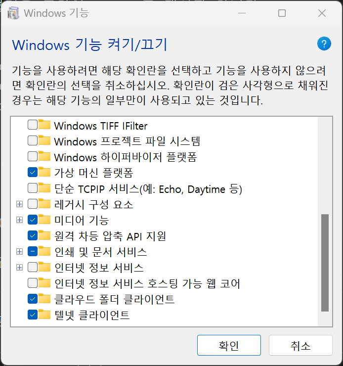

[⬅️ 이전](../) &nbsp;|&nbsp; [🏠 분류 목차](../../../)

# 텔넷 클라이언트

## 텔넷 클라이언트

### 윈도우 기본 telnet 클라이 언트를 설치한다.
`제어판`에 가서 `프로그램 및 기능`을 선택합니다. 
오른쪽 메뉴에서 `Windows 기능 켜기/끄기`를 선택합니다.
[텔넷 클라이언트]를 부분을 활성화 합니다.

* 명령 프롬프트(관리자)를 실행(윈도우키+x)

---

[⬅️ 이전: 래드햇 계열에서 OpenSSH 설치하기](../06_4_4_ssh/yum/) &nbsp;|&nbsp; [🏠 분류 목차](../../../) &nbsp;|&nbsp; [다음: VNC ➡️](../06_4_6_vnc/)

---

[⬅️ 이전](../)
