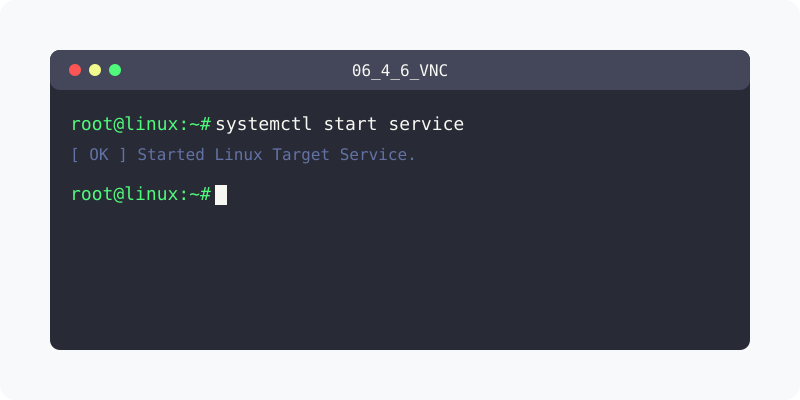

[⬅️ 이전](../) &nbsp;|&nbsp; [🏠 분류 목차](../../../)

# VNC
VNC는 일반적인 터미널 모드와 달리 그래픽 모드로 서버를 원격 관리를 할 수 있습니다.

방대한 주제를 분할하여 제공합니다.

## 1️⃣ 핵심 학습 가이드
* [VNC 서버](part_1/)

  해당 파트의 상세 내용을 학습합니다.

* [VNC 서버 설치](part_2/)

  해당 파트의 상세 내용을 학습합니다.

## 2️⃣ 심화 및 활용 파트 1
* [Client에서 Server에 접속하기](part_3/)

  해당 파트의 상세 내용을 학습합니다.

* [접속확인](part_4/)

  해당 파트의 상세 내용을 학습합니다.

---

[⬅️ 이전](../) &nbsp;|&nbsp; [🏠 분류 목차](../../../)
