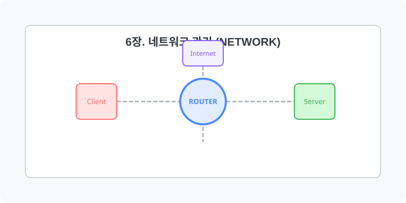

[⬅️ 이전: 24.시스템 관리](../06_system/05_5_storage/) &nbsp;|&nbsp; [🏠 분류 목차](../) &nbsp;|&nbsp; [다음: 9.1 리눅스 네트워크 구조 ➡️](06_1_basic/)

# 6장. 네트워크 관리 (Network)

리눅스 네트워크 환경의 구조를 이해하고 IP 설정, 라우팅, 방화벽 및 원격 관리 기법을 학습합니다.
아래의 세부 학습 주제를 챕터별로 클릭하여 상세 레퍼런스를 확인하세요.

본 단원의 세부 커리큘럼을 안내합니다.

## 1️⃣ 핵심 학습 가이드
* [6.1 Basic](06_1_basic/)
  * 학습 내용: `hardware, host, hostname, icmp 등...`

* [6.2 Structure](06_2_structure/)

## 2️⃣ 심화 및 활용 파트 1
* [6.3 Ip](06_3_ip/)

* [6.4 Remote](06_4_remote/)
  * 학습 내용: `_remote, netstat, putty, ssh 등...`

## 3️⃣ 심화 및 활용 파트 2
* [6.5 System](06_5_system/)

## 3️⃣ 심화 및 활용 파트 2
---

[⬅️ 이전: 24.시스템 관리](../06_system/05_5_storage/) &nbsp;|&nbsp; [🏠 분류 목차](../) &nbsp;|&nbsp; [다음: 9.1 리눅스 네트워크 구조 ➡️](06_1_basic/)
