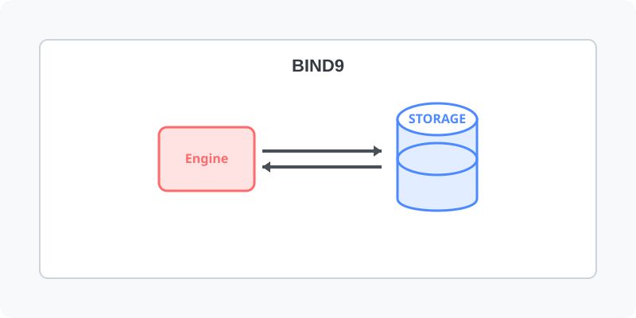

[⬅️ 이전](../) &nbsp;|&nbsp; [🏠 분류 목차](../../../)

# bind9
Ubuntu에 BIND(Berkeley Internet Name Domain)를 설치합니다.

방대한 주제를 분할하여 제공합니다.

## 1️⃣ 핵심 학습 가이드
* [패키지 설치](part_1/)

  해당 파트의 상세 내용을 학습합니다.

* [설정](part_2/)

  해당 파트의 상세 내용을 학습합니다.

## 2️⃣ 심화 및 활용 파트 1
* [테스트](part_3/)

  해당 파트의 상세 내용을 학습합니다.

* [도메인 등록 기관](part_4/)

  해당 파트의 상세 내용을 학습합니다.

## 3️⃣ 심화 및 활용 파트 2
* [Slave DNS 구성](part_5/)

  해당 파트의 상세 내용을 학습합니다.

* [웹기반 DNS 설정 도구](part_6/)

  해당 파트의 상세 내용을 학습합니다.

## 3️⃣ 심화 및 활용 파트 2
---

[⬅️ 이전](../) &nbsp;|&nbsp; [🏠 분류 목차](../../../)
