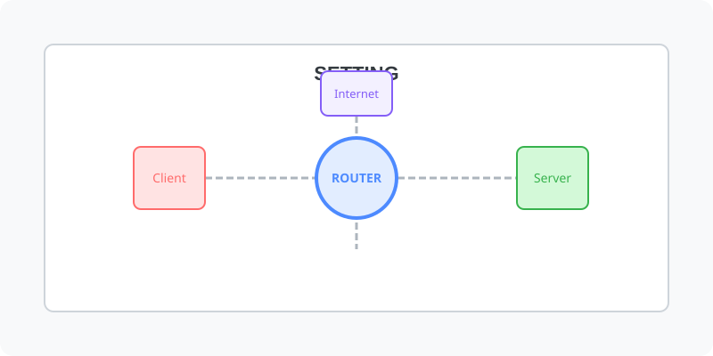

[⬅️ 이전](../) &nbsp;|&nbsp; [🏠 분류 목차](../../../)

# 실습 DNS 서버 변경

방대한 주제를 분할하여 제공합니다.

## 1️⃣ 핵심 학습 가이드
* [DNS 서버 작동 확인하기](part_1/)

  해당 파트의 상세 내용을 학습합니다.

* [nm-connection-editor 명령 입력](part_2/)

  해당 파트의 상세 내용을 학습합니다.

## 2️⃣ 심화 및 활용 파트 1
* [reboot 명령으로 재부팅](part_3/)

  해당 파트의 상세 내용을 학습합니다.

* [DNS 서버 테스트하기](part_4/)

  해당 파트의 상세 내용을 학습합니다.

## 3️⃣ 심화 및 활용 파트 2
* [Resolv 수정](part_5/)

  해당 파트의 상세 내용을 학습합니다.

## 3️⃣ 심화 및 활용 파트 2
---

[⬅️ 이전](../) &nbsp;|&nbsp; [🏠 분류 목차](../../../)
