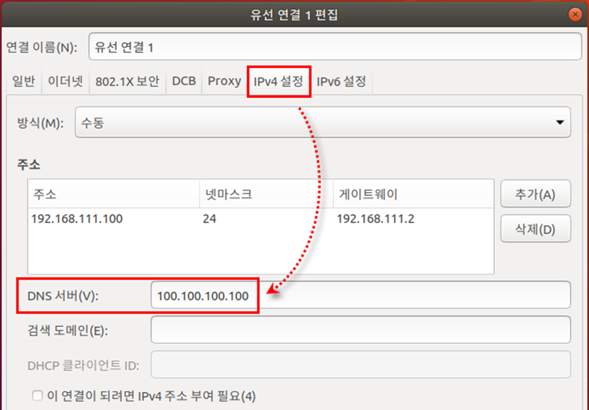
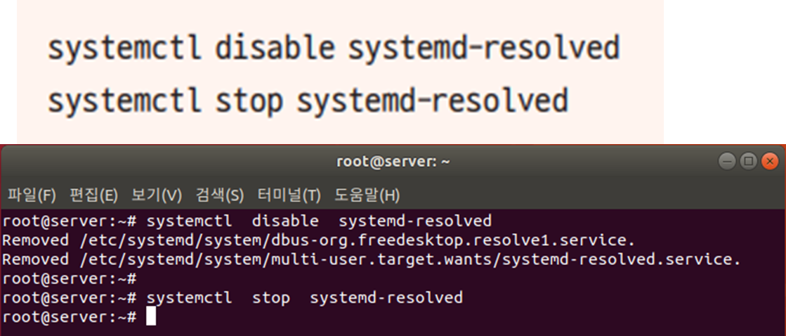
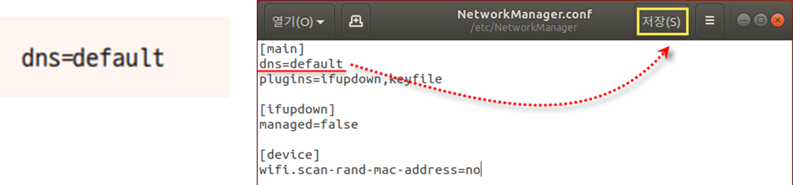
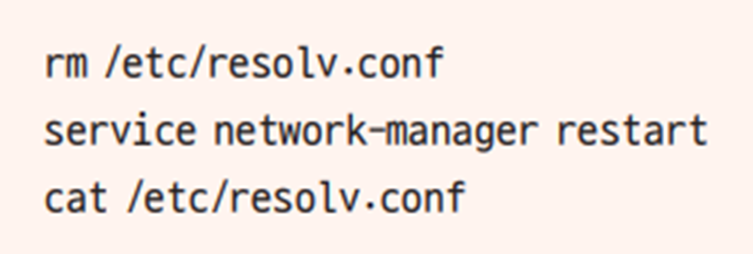
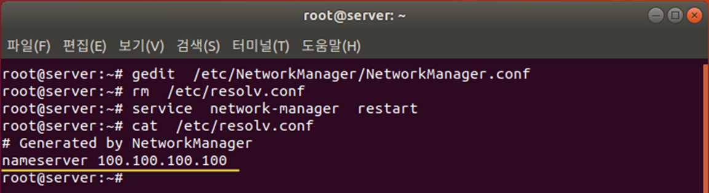

[⬅️ 이전](../) &nbsp;|&nbsp; [🏠 분류 목차](../../../)

# nm-connection-editor 명령 입력

## nm-connection-editor 명령 입력

* 잘못된 DNS 주소인 ‘100.100.100.100’을 입력하고 저장한 후 [네트워크 연결] 창 닫기      

  → DNS 서버가 고장 나거나 주소를 잘못 입력한 경우 서버가 응답하지 않음

5-3 만약 systemd-resolved 데몬이 돌고 있으면 종료시킨다. 

`/etc/NetworkManager/NetworkManager.conf` 

[main] 아래에 다음 한 줄을 추가하여 저장한 후 종료

DNS 서버가 설정되어 있는 resolv.conf 파일을 다음 명령으로 삭제

* network-manager 서비스를 시작하여 DNS가 100.100.100.100인 것을 확인

* Network-manager를 재시작하면서 resolv.conf 새로 생성

---

[⬅️ 이전](../)
