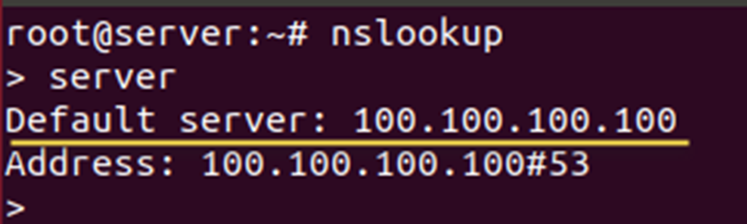
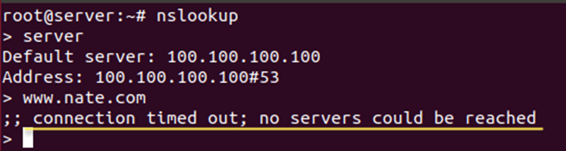

[⬅️ 이전](../) &nbsp;|&nbsp; [🏠 분류 목차](../../../)

# DNS 서버 테스트하기

## DNS 서버 테스트하기

* 6-1 터미널에서 nslookup 명령을 입력하면 프롬프트가 ‘>’로 바뀜

* ‘server’를 입력했을 때 나오는 결과가 현재 Server에 설정된 DNS 서버 주소

* 기본으로 설정된 DNS 서버 주소는 /etc/resolv.conf 파일에 설정한 잘못된 주소인 100.100.100.100

‘www.google.com’을 입력하면 오류 메시지가 나타남

현재 설정된 DNS 서버 주소(100.100.100.100)가 응답하지 않기 때문

---

[⬅️ 이전](../)
