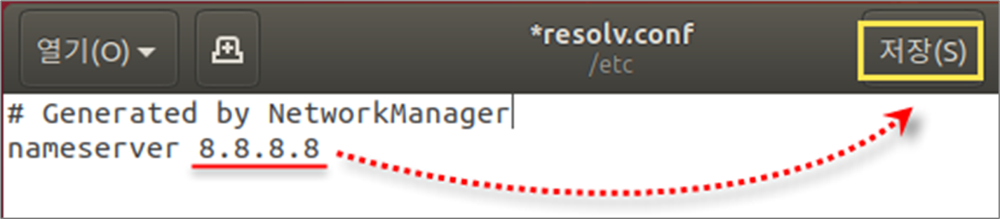
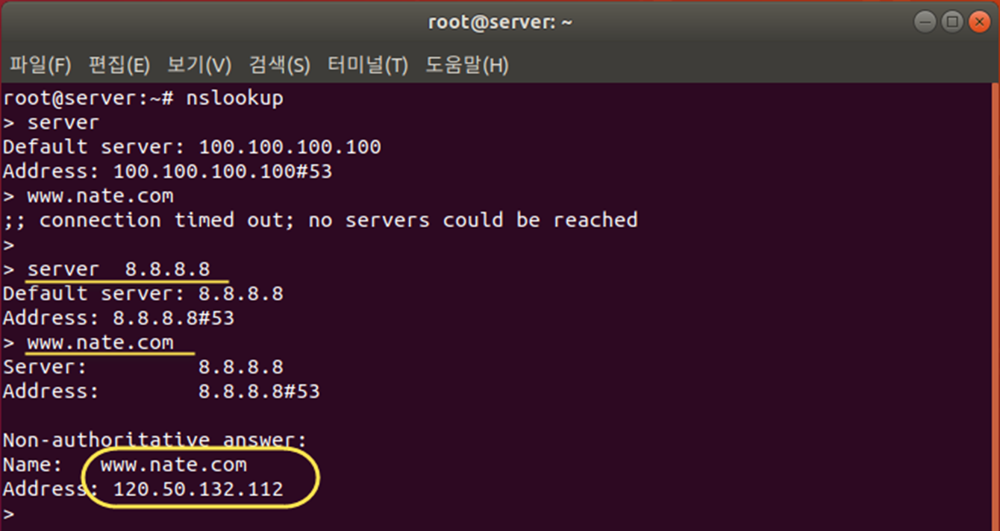

[⬅️ 이전](../) &nbsp;|&nbsp; [🏠 분류 목차](../../../)

# Resolv 수정

## Resolv 수정
vi 에디터나 gedit로 /etc/resolv.conf 파일 열기

* 정상 작동을 확인한 구글의 ‘8.8.8.8’을 입력한 후 저장

웹 브라우저를 실행하여 잘 접속되는지 확인 è 정상 동작 

* 6-5 DNS 서버를 영구적으로 설정하기 위해 다시 nm-connection-editor 명령 사용

* 정상적인 DNS 서버 주소인 ‘8.8.8.8’을 입력하고 저장

* reboot 명령으로 재부팅

server 새로운 DNS서버 IP주소 확인

* DNS 서버 주소 변경 완료 : 8.8.8.8

* 다시 ‘www.google.com’ 입력 – 정상 동작 확인

---

[⬅️ 이전: nslookup](../nslookup/) &nbsp;|&nbsp; [🏠 분류 목차](../../../../../) &nbsp;|&nbsp; [다음: FTP ➡️](../../ftp/)

---

[⬅️ 이전](../)
